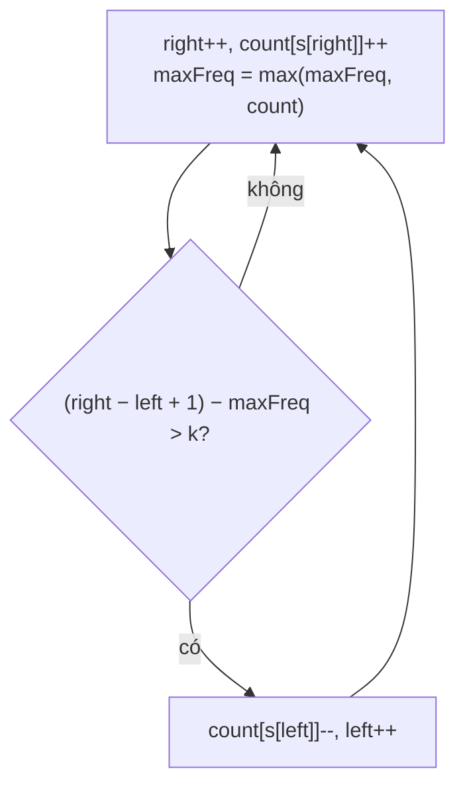

<!-- approaches: Brute force with counts · Sliding window with max frequency -->
# 424. Longest Repeating Character Replacement

**Medium** · Hash Table · String · Sliding Window · [LeetCode ↗](https://leetcode.com/problems/longest-repeating-character-replacement/) · Code: [LongestRepeatingCharacterReplacement.java](LongestRepeatingCharacterReplacement.java) · Tests: [LongestRepeatingCharacterReplacementTest.java](LongestRepeatingCharacterReplacementTest.java)

## Đề bài

Được đổi tối đa `k` ký tự thành chữ khác. Tìm chuỗi con dài nhất gồm **một loại chữ** sau khi đổi.

```
("AABABBA", k = 1) -> 4    đổi B ở giữa: "AABA" → "AAAA"
```

## Ý tưởng

> Một cửa sổ "đạt" khi số ký tự **phải đổi** không vượt `k`. Số ký tự phải đổi = **độ dài cửa sổ − số lần xuất hiện của chữ nhiều nhất** trong cửa sổ.
> → Cửa sổ trượt: mở rộng `right`; nếu cửa sổ không đạt thì trượt `left` lên một bước.



`"AABABBA"`, `k = 1`:

| right | cửa sổ | maxFreq | phải đổi | hành động |
|---|---|---|---|---|
| 0–2 | AAB | 2 | 1 | ok |
| 3 | AABA | 3 | 1 | ok (dài 4) |
| 4 | AABAB | 3 | 2 | trượt → ABAB |
| 5 | ABABB | 3 | 2 | trượt → BABB |
| 6 | BABBA | 3 | 2 | trượt → ABBA |

Kết quả = 4.

## Cách 1 — Vét cạn `O(n²)`

## Cách 2 — Cửa sổ trượt `O(n)` ⭐

**Mẹo tinh tế:** không cần giảm `maxFreq` khi `left` tiến lên. Đáp án chỉ tăng khi tìm được cửa sổ có `maxFreq` **lớn hơn** — một `maxFreq` cũ (lớn hơn thực tế) chỉ khiến cửa sổ **trượt** thay vì **co**, nên độ dài lớn nhất đã đạt được không bao giờ giảm. Vì vậy đáp án chính là kích thước cửa sổ cuối: `n − left`.

## Bài liên quan

3 Longest Substring Without Repeating Characters · 1004 Max Consecutive Ones III (cùng khuôn với k = số số 0 được lật) · 76 Minimum Window Substring.
