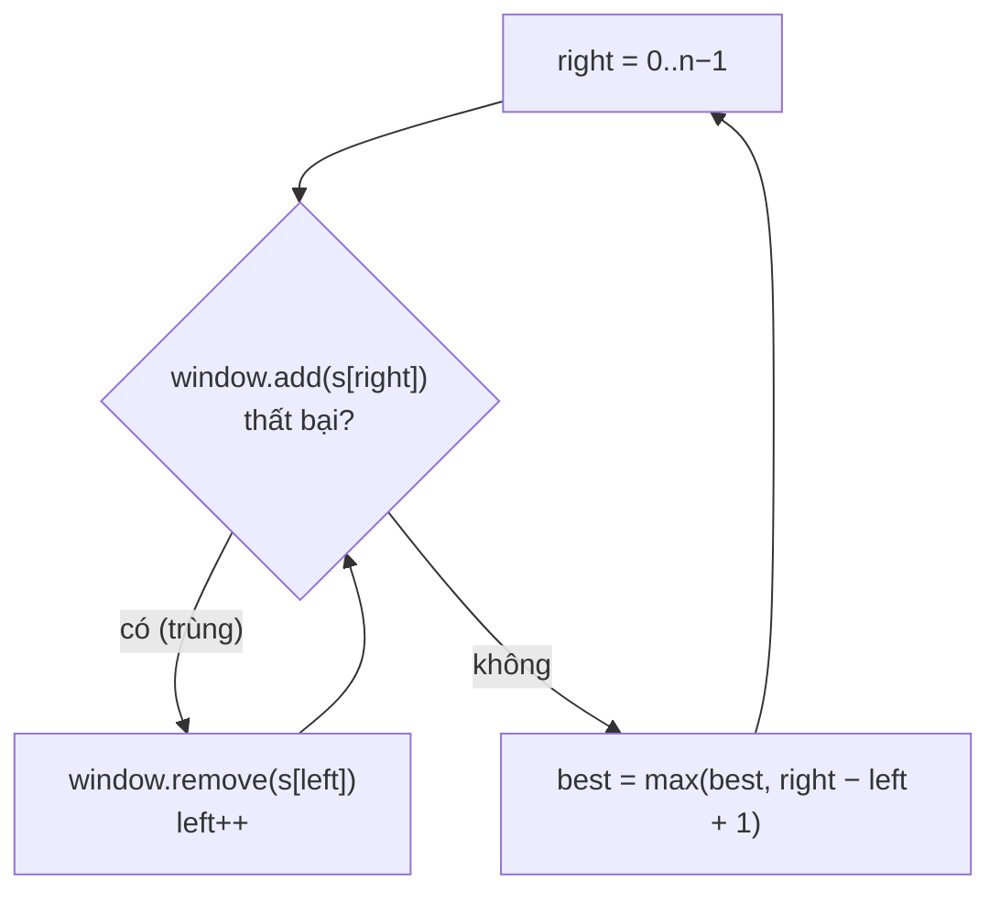

<!-- approaches: Brute force · Sliding window + set · Sliding window + last index -->
# 3. Longest Substring Without Repeating Characters

**Medium** · Hash Table · String · Sliding Window · [LeetCode ↗](https://leetcode.com/problems/longest-substring-without-repeating-characters/) · Code: [LongestSubstringWithoutRepeatingCharacters.java](LongestSubstringWithoutRepeatingCharacters.java) · Tests: [LongestSubstringWithoutRepeatingCharactersTest.java](LongestSubstringWithoutRepeatingCharactersTest.java)

## Đề bài

Độ dài **chuỗi con liên tiếp** dài nhất không có ký tự lặp.

```
"abcabcbb" -> 3 ("abc")      "bbbbb" -> 1      "pwwkew" -> 3 ("wke"; "pwke" là dãy con, không liên tiếp)
```

## Ý tưởng

> **Cửa sổ trượt** `[left, right]` luôn chứa các ký tự khác nhau. Mở rộng `right` từng bước;
> khi ký tự mới bị trùng, kéo `left` sang phải cho tới khi hết trùng. Mỗi ký tự vào và ra cửa sổ tối đa một lần → `O(n)`.

Đây là **khuôn mẫu sliding window** quan trọng nhất — xuất hiện ở hàng chục bài khác.

## Cách 1 — Vét cạn `O(n·k)`

Từ mỗi điểm bắt đầu, kéo dài tới khi gặp ký tự trùng.

## Cách 2 — Cửa sổ + HashSet `O(n)`



## Cách 3 — Cửa sổ + chỉ số lần cuối `O(n)` ⭐

Thay vì kéo `left` từng bước, **nhảy thẳng** tới sau lần xuất hiện trước: `left = max(left, last[c] + 1)`.

`"abcabcbb"`:

| right | c | last[c] trước | left | cửa sổ | best |
|---|---|---|---|---|---|
| 0 | a | −1 | 0 | a | 1 |
| 1 | b | −1 | 0 | ab | 2 |
| 2 | c | −1 | 0 | abc | 3 |
| 3 | a | 0 | 1 | bca | 3 |
| 4 | b | 1 | 2 | cab | 3 |
| 5 | c | 2 | 3 | abc | 3 |
| 6 | b | 4 | 5 | cb | 3 |
| 7 | b | 6 | 7 | b | 3 |

## Bẫy & lưu ý

- **`max`** trong `left = max(left, last[c] + 1)` là bắt buộc: với `"abba"`, khi gặp `a` cuối, `last[a] + 1 = 1` nằm **sau** `left = 2` — không được lùi `left`.
- Chuỗi có thể chứa chữ, số, ký hiệu, dấu cách → mảng `int[128]` (ASCII) hoặc HashMap.

## Bài liên quan

159/340 Longest Substring with At Most K Distinct Characters · 424 Longest Repeating Character Replacement · 76 Minimum Window Substring · 438 Find All Anagrams.
