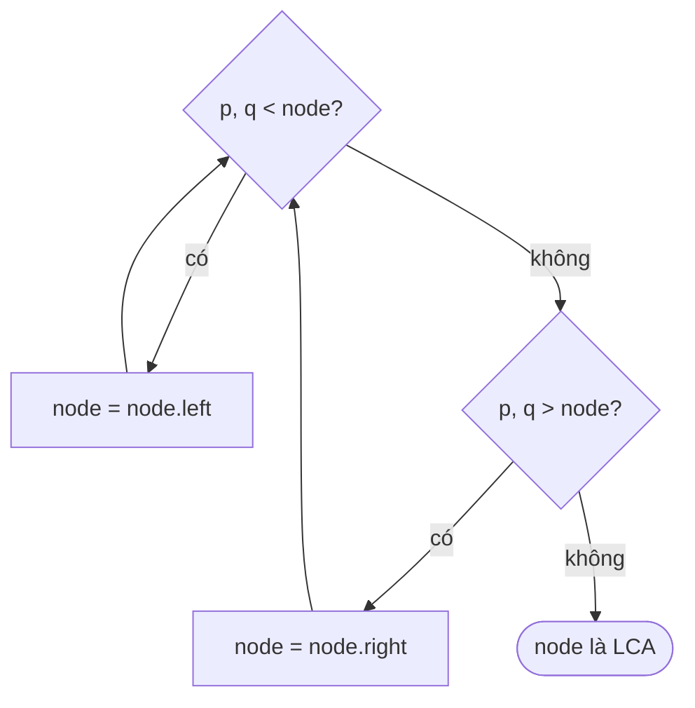

<!-- approaches: Recursive using BST order · Iterative -->
# 235. Lowest Common Ancestor of a Binary Search Tree

**Medium** · Tree · Depth-First Search · Binary Search Tree · Binary Tree · [LeetCode ↗](https://leetcode.com/problems/lowest-common-ancestor-of-a-binary-search-tree/) · Code: [LowestCommonAncestorOfABinarySearchTree.java](LowestCommonAncestorOfABinarySearchTree.java) · Tests: [LowestCommonAncestorOfABinarySearchTreeTest.java](LowestCommonAncestorOfABinarySearchTreeTest.java)

## Đề bài

Trong **BST**, tìm **tổ tiên chung thấp nhất** (LCA) của hai node `p` và `q` (một node được coi là tổ tiên của chính nó).

```
        6
      /   \
     2     8          p = 2, q = 8 -> 6
    / \   / \         p = 2, q = 4 -> 2
   0   4 7   9
      / \
     3   5
```

## Ý tưởng

> Đi từ gốc xuống. Nếu `p` và `q` đều **nhỏ hơn** node hiện tại → cả hai nằm bên trái, đi trái. Đều **lớn hơn** → đi phải.
> Ngược lại (một bên trái một bên phải, hoặc một trong hai **chính là** node hiện tại) → đây là điểm hai đường đi **tách nhau** = LCA.



## Cách 1 — Đệ quy `O(h)`

## Cách 2 — Vòng lặp `O(h) · O(1)` ⭐

Chỉ đi theo **một** nhánh → không cần stack.

## Bẫy & lưu ý

- Điều kiện "tách nhau" bao gồm cả trường hợp `p == node` hoặc `q == node`.
- Lời giải này **dựa vào thứ tự BST**. Cây nhị phân thường cần cách khác (bài 236).

## Bài liên quan

236 LCA of a Binary Tree · 1650 LCA III (có con trỏ cha) · 700 Search in a BST.
