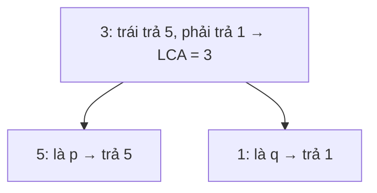

<!-- approaches: Recursive postorder · Parent pointers + ancestor set -->
# 236. Lowest Common Ancestor of a Binary Tree

**Medium** · Tree · Depth-First Search · Binary Tree · Binary Lifting · [LeetCode ↗](https://leetcode.com/problems/lowest-common-ancestor-of-a-binary-tree/) · Code: [LowestCommonAncestorOfABinaryTree.java](LowestCommonAncestorOfABinaryTree.java) · Tests: [LowestCommonAncestorOfABinaryTreeTest.java](LowestCommonAncestorOfABinaryTreeTest.java)

## Đề bài

Cây nhị phân **thường** (không phải BST). Tìm tổ tiên chung thấp nhất của hai node `p`, `q` (một node là tổ tiên của chính nó).

```
        3
      /   \
     5     1           p = 5, q = 1 -> 3
    / \   / \          p = 5, q = 4 -> 5
   6   2 0   8
      / \
     7   4
```

## Ý tưởng

> Hỏi mỗi cây con: "**có thấy `p` hoặc `q` không?**" (postorder — hỏi con trước rồi mới quyết định ở node hiện tại).
> - Cả trái và phải đều báo thấy → `p` và `q` ở **hai phía** → node hiện tại là LCA.
> - Chỉ một phía báo thấy → chuyển tiếp kết quả của phía đó lên trên.
> - Node hiện tại **chính là** `p` hoặc `q` → trả về luôn (nếu node kia nằm bên dưới thì đây cũng là LCA).



## Cách 1 — Đệ quy postorder `O(n) · O(h)` ⭐

Năm dòng code. Mẹo: khi gặp `p` thì trả về luôn mà không cần tìm `q` bên dưới — nếu `q` ở dưới `p` thì `p` là LCA; nếu `q` ở nơi khác thì phía kia sẽ tìm thấy nó.

## Cách 2 — Con trỏ cha + tập tổ tiên

1. Duyệt cây, ghi `parent` của mỗi node.
2. Từ `p` đi lên gốc, gom tất cả tổ tiên vào một tập.
3. Từ `q` đi lên tới khi gặp một node trong tập.

Dễ hiểu, dùng được khi cần trả lời **nhiều truy vấn** (lưu `parent` một lần).

## Bài liên quan

235 LCA of a BST (dễ hơn nhờ thứ tự) · 1650 LCA III (có sẵn con trỏ cha — như 160 Intersection of Two Linked Lists) · 1123 LCA of Deepest Leaves.
