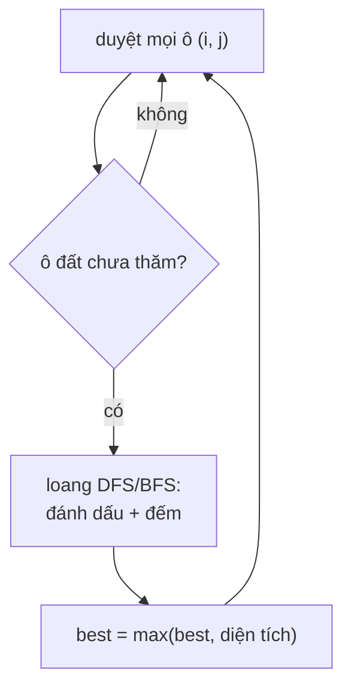

<!-- approaches: Recursive DFS · Iterative BFS · Union-find -->
# 695. Max Area of Island

**Medium** · Array · Depth-First Search · Breadth-First Search · Union-Find · [LeetCode ↗](https://leetcode.com/problems/max-area-of-island/) · Code: [MaxAreaOfIsland.java](MaxAreaOfIsland.java) · Tests: [MaxAreaOfIslandTest.java](MaxAreaOfIslandTest.java)

## Đề bài

Lưới nhị phân; **đảo** là nhóm ô `1` nối nhau theo 4 hướng. Tìm diện tích đảo **lớn nhất**.

```
1 1 0 0 0
1 1 0 0 0      -> 4
0 0 0 1 1
0 0 0 1 1
```

## Ý tưởng

> Duyệt từng ô; gặp ô đất **chưa thăm** thì **loang** (flood fill) ra toàn bộ đảo chứa nó, đếm số ô. Đánh dấu ô đã thăm để không đếm lại.



Đây là **khuôn flood fill trên lưới** — dùng cho 200, 463, 733, 130, 417, 994.

## Cách 1 — DFS đệ quy, "nhấn chìm" ô đã thăm ⭐

Đặt ô thành `0` khi thăm thay cho mảng `visited`. Code chép lưới ra bản sao để không sửa đầu vào.

## Cách 2 — BFS bằng hàng đợi

Tránh tràn stack khi đảo rất lớn (lưới 1000 × 1000 toàn đất → đệ quy sâu 10⁶ tầng). **Đánh dấu khi đưa vào hàng đợi**, không phải khi lấy ra — nếu không một ô có thể bị đưa vào nhiều lần.

## Cách 3 — Union-Find (Disjoint Set)

Mỗi ô đất là một phần tử; hợp nhất với ô đất bên phải và bên dưới. Lưu kích thước mỗi tập (`size`). Hữu ích khi đất được **thêm dần** (bài 305 Number of Islands II).

## Độ phức tạp

Cả ba: `O(m · n)` thời gian (Union-Find gần như vậy với nén đường đi + hợp theo kích thước).

## Bài liên quan

200 Number of Islands · 463 Island Perimeter · 827 Making A Large Island (Hard) · 1020 Number of Enclaves.
