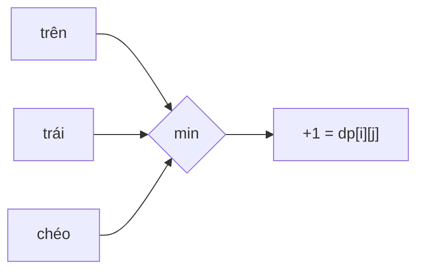

<!-- approaches: DP: side = 1 + min(top, left, top-left) · 1D rolling row -->
# 221. Maximal Square

**Medium** · Array · Dynamic Programming · Matrix · [LeetCode ↗](https://leetcode.com/problems/maximal-square/) · Code: [MaximalSquare.java](MaximalSquare.java) · Tests: [MaximalSquareTest.java](MaximalSquareTest.java)

## Đề bài

Ma trận `0/1`. Tìm hình vuông lớn nhất chỉ gồm `1`, trả về **diện tích**.

```
1 0 1 0 0
1 0 1 1 1
1 1 1 1 1      -> 4  (hình vuông 2×2)
1 0 0 1 0
```

## Ý tưởng

> `dp[i][j]` = cạnh của hình vuông toàn `1` lớn nhất có **góc dưới phải** tại `(i, j)`.
> Nếu ô là `1`: **`dp = 1 + min(trên, trái, chéo trên-trái)`**. Hình vuông chỉ lớn bằng "nước đi" ngắn nhất trong ba hướng.



Bảng `dp` của ví dụ:

| | | | | |
|---|---|---|---|---|
| 1 | 0 | 1 | 0 | 0 |
| 1 | 0 | 1 | 1 | 1 |
| 1 | 1 | 1 | **2** | **2** |
| 1 | 0 | 0 | 1 | 0 |

Cạnh lớn nhất 2 → diện tích 4.

## Cách 1 — DP 2 chiều `O(m·n)` ⭐

Thêm một hàng và một cột đệm số 0 để không phải kiểm tra biên.

## Cách 2 — Một hàng `O(n)` bộ nhớ

Biến `diag` giữ giá trị `dp[i−1][j−1]` trước khi bị ghi đè.

## Bài liên quan

85 Maximal Rectangle (Hard) · 1277 Count Square Submatrices with All Ones · 84 Largest Rectangle in Histogram.
