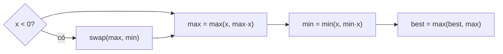

<!-- approaches: Track both max and min ending here · Prefix/suffix products -->
# 152. Maximum Product Subarray

**Medium** · Array · Dynamic Programming · [LeetCode ↗](https://leetcode.com/problems/maximum-product-subarray/) · Code: [MaximumProductSubarray.java](MaximumProductSubarray.java) · Tests: [MaximumProductSubarrayTest.java](MaximumProductSubarrayTest.java)

## Đề bài

Tìm đoạn con liên tiếp có **tích lớn nhất**.

```
[2,3,-2,4] -> 6     [-2,3,-4] -> 24
```

## Ý tưởng

> Khác bài 53 (tổng): nhân với **số âm** biến số lớn nhất thành nhỏ nhất và ngược lại. Một tích rất âm có thể thành rất dương ở bước sau.
> → Với mỗi vị trí giữ **cả** `max` và `min` của tích các đoạn kết thúc tại đó. Gặp số âm thì **đổi chỗ** hai giá trị trước khi nhân.

`[-2, 3, -4]`:

| x | max | min | best |
|---|---|---|---|
| −2 | −2 | −2 | −2 |
| 3 | 3 | −6 | 3 |
| −4 | (đổi) max(−4, −6·−4) = **24** | min(−4, 3·−4) = −12 | 24 |



## Cách 1 — Giữ cả max và min `O(n)` ⭐

So với `x` một mình nghĩa là "bắt đầu đoạn mới tại `x`" — cũng xử lý luôn số 0.

## Cách 2 — Tích tiền tố và hậu tố

Trong một đoạn không có số 0: số số âm **chẵn** → lấy hết; **lẻ** → bỏ một tiền tố hoặc một hậu tố. Vậy đáp án luôn là một tích tiền tố hoặc hậu tố (gặp 0 thì bắt đầu lại).

## Bài liên quan

53 Maximum Subarray · 628 Maximum Product of Three Numbers · 1567 Maximum Length of Subarray With Positive Product.
