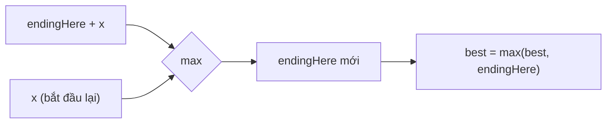

<!-- approaches: Brute force · Kadane · Divide and conquer · Prefix sums -->
# 53. Maximum Subarray

**Medium** · Array · Divide and Conquer · Dynamic Programming · [LeetCode ↗](https://leetcode.com/problems/maximum-subarray/) · Code: [MaximumSubarray.java](MaximumSubarray.java) · Tests: [MaximumSubarrayTest.java](MaximumSubarrayTest.java)

## Đề bài

Tìm đoạn con **liên tiếp** có tổng **lớn nhất**.

```
[-2,1,-3,4,-1,2,1,-5,4] -> 6   (đoạn [4,-1,2,1])
```

## Ý tưởng — Kadane

> `endingHere` = tổng lớn nhất của đoạn **kết thúc tại** vị trí hiện tại. Ở mỗi bước chỉ có hai lựa chọn: **nối tiếp** đoạn trước (`endingHere + x`) hoặc **bắt đầu lại** từ `x`. Đoạn trước có tổng âm thì nối vào chỉ làm thiệt → bắt đầu lại.

| x | −2 | 1 | −3 | 4 | −1 | 2 | 1 | −5 | 4 |
|---|---|---|---|---|---|---|---|---|---|
| endingHere | −2 | 1 | −2 | 4 | 3 | 5 | **6** | 1 | 5 |
| best | −2 | 1 | 1 | 4 | 4 | 5 | **6** | 6 | 6 |



## Cách 1 — Vét cạn `O(n²)`

## Cách 2 — Kadane `O(n) · O(1)` ⭐

Đây là DP một chiều thu gọn: `dp[i] = max(nums[i], dp[i−1] + nums[i])`.

## Cách 3 — Chia để trị `O(n log n)` (follow-up)

Đoạn tốt nhất hoặc nằm hoàn toàn ở **nửa trái**, hoặc **nửa phải**, hoặc **vắt qua giữa** (= tổng hậu tố tốt nhất của nửa trái + tổng tiền tố tốt nhất của nửa phải). Ý tưởng này là nền tảng của **segment tree** cho truy vấn "tổng đoạn con lớn nhất trong khoảng".

## Cách 4 — Prefix sum

Tổng đoạn `(i, j]` = `prefix[j] − prefix[i]` → với mỗi `j`, trừ đi prefix **nhỏ nhất** phía trước. Cùng tư duy với 121 Best Time to Buy and Sell Stock.

## Bẫy & lưu ý

- Mảng toàn số âm → đáp án là số lớn nhất (đoạn phải khác rỗng). Đừng khởi tạo `best = 0`.

## Bài liên quan

152 Maximum Product Subarray · 918 Maximum Sum Circular Subarray · 121 Best Time to Buy and Sell Stock · 1186 Maximum Subarray Sum with One Deletion.
