<!-- approaches: Sort by start + merge · Sort starts and ends separately -->
# 56. Merge Intervals

**Medium** · Array · Sorting · Quicksort · [LeetCode ↗](https://leetcode.com/problems/merge-intervals/) · Code: [MergeIntervals.java](MergeIntervals.java) · Tests: [MergeIntervalsTest.java](MergeIntervalsTest.java)

## Đề bài

Gộp mọi khoảng **chồng nhau** (kể cả chạm đầu mút) thành các khoảng rời nhau.

```
[[1,3],[2,6],[8,10],[15,18]] -> [[1,6],[8,10],[15,18]]
```

## Ý tưởng

> **Sắp xếp theo điểm bắt đầu.** Sau đó các khoảng chồng nhau luôn đứng **liền nhau**. Đi một lượt: khoảng mới bắt đầu **trong** khoảng đang gộp (`start ≤ end hiện tại`) thì nới `end`; không thì mở khoảng gộp mới.

```mermaid
gantt
    dateFormat X
    axisFormat %s
    section đầu vào
    [1,3]   : 1, 3
    [2,6]   : 2, 6
    [8,10]  : 8, 10
    [15,18] : 15, 18
    section kết quả
    [1,6]   :done, 1, 6
    [8,10]  :done, 8, 10
    [15,18] :done, 15, 18
```



| khoảng | khoảng đang gộp | hành động |
|---|---|---|
| [1,3] | – | mở [1,3] |
| [2,6] | [1,3] | 2 ≤ 3 → nới thành [1,6] |
| [8,10] | [1,6] | 8 > 6 → mở mới |
| [15,18] | [8,10] | 15 > 10 → mở mới |

## Cách 1 — Sắp xếp theo start + gộp ⭐

Nhớ dùng `max(end cũ, end mới)` — khoảng mới có thể nằm **gọn bên trong** khoảng cũ (`[1,10]` rồi `[2,3]`).

## Cách 2 — Sắp xếp riêng starts và ends

Một khối gộp kết thúc tại `ends[i]` khi `starts[i+1] > ends[i]`. Đúng vì ta chỉ quan tâm **đường bao** của các khối, không quan tâm khoảng nào ghép với khoảng nào. Vòng lặp trên mảng nguyên thuỷ, nhanh hơn.

## Bài liên quan

57 Insert Interval · 435 Non-overlapping Intervals · 252/253 Meeting Rooms · 986 Interval List Intersections · 763 Partition Labels.
