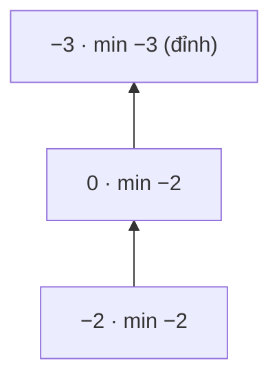

<!-- approaches: Stack of (value, current min) pairs · Two stacks · Single stack storing differences -->
# 155. Min Stack

**Medium** · Stack · Design · [LeetCode ↗](https://leetcode.com/problems/min-stack/) · Code: [MinStack.java](MinStack.java) · Tests: [MinStackTest.java](MinStackTest.java)

## Đề bài

Thiết kế stack hỗ trợ `push`, `pop`, `top` và `getMin` (lấy phần tử nhỏ nhất), **tất cả `O(1)`**.

## Ý tưởng

> Phần tử nhỏ nhất chỉ thay đổi khi **push** hoặc **pop**, và stack chỉ thay đổi ở **đỉnh**. Nên mỗi tầng của stack có thể **ghi nhớ min của mọi thứ bên dưới nó** — pop xong thì min cũ tự hiện ra.

| thao tác | stack (giá trị, min tới đây) | getMin |
|---|---|---|
| push −2 | (−2, −2) | −2 |
| push 0 | (−2, −2) (0, −2) | −2 |
| push −3 | … (−3, −3) | −3 |
| pop | (−2, −2) (0, −2) | −2 |

## Cách 1 — Stack các cặp (giá trị, min) ⭐

Đơn giản, khó sai nhất.

## Cách 2 — Hai stack

Stack phụ chỉ lưu các giá trị là **min mới** (`≤` min hiện tại — phải dùng `≤` để giữ cả các min trùng nhau). Khi pop đúng giá trị đang là min thì pop luôn stack phụ. Tiết kiệm bộ nhớ khi min ít thay đổi.

## Cách 3 — Một stack lưu độ chênh lệch

Lưu `val − min` (dạng `long` để không tràn). Chênh lệch **âm** nghĩa là phần tử này đã tạo min mới, và từ nó suy ra được min trước đó khi pop: `min_cũ = min − diff`. Mẹo hay để kể, nhưng dễ sai — chỉ dùng khi bị hỏi "không thêm bộ nhớ".

## Bài liên quan

716 Max Stack (Hard) · 232 Implement Queue using Stacks · 239 Sliding Window Maximum (deque đơn điệu).
