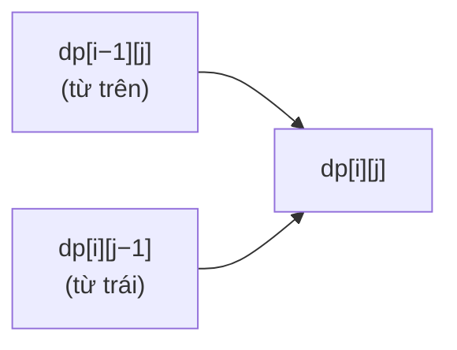

<!-- approaches: Memoized recursion · 2D DP table · 1D rolling row -->
# 64. Minimum Path Sum

**Medium** · Array · Dynamic Programming · Matrix · [LeetCode ↗](https://leetcode.com/problems/minimum-path-sum/) · Code: [MinimumPathSum.java](MinimumPathSum.java) · Tests: [MinimumPathSumTest.java](MinimumPathSumTest.java)

## Đề bài

Lưới số không âm. Đi từ góc **trên trái** tới **dưới phải**, mỗi bước chỉ sang **phải** hoặc **xuống**. Tìm tổng nhỏ nhất trên đường đi.

```
1 3 1
1 5 1      -> 7   (1 → 3 → 1 → 1 → 1)
4 2 1
```

## Ý tưởng

> Muốn tới ô `(i, j)` thì bước cuối phải từ ô **trên** hoặc ô **trái**. Chọn đường rẻ hơn trong hai đường đó:
> `dp[i][j] = grid[i][j] + min(dp[i−1][j], dp[i][j−1])`.



Bảng `dp` cho ví dụ:

| | c0 | c1 | c2 |
|---|---|---|---|
| r0 | 1 | 4 | 5 |
| r1 | 2 | 7 | 6 |
| r2 | 6 | 8 | **7** |

## Cách 1 — Đệ quy có nhớ

## Cách 2 — Bảng 2 chiều `O(m·n)`

Hàng đầu chỉ đi từ trái sang, cột đầu chỉ đi từ trên xuống — xử lý riêng.

## Cách 3 — Một hàng `O(n)` bộ nhớ ⭐

Khi tính `dp[j]` của hàng hiện tại: `dp[j]` (chưa ghi đè) là giá trị **hàng trên**, `dp[j−1]` (vừa ghi) là giá trị **bên trái** cùng hàng. Đây là kỹ thuật "**cuộn hàng**" dùng cho hầu hết DP lưới.

## Bài liên quan

62 Unique Paths · 63 Unique Paths II · 120 Triangle · 174 Dungeon Game (Hard) · 931 Minimum Falling Path Sum.
