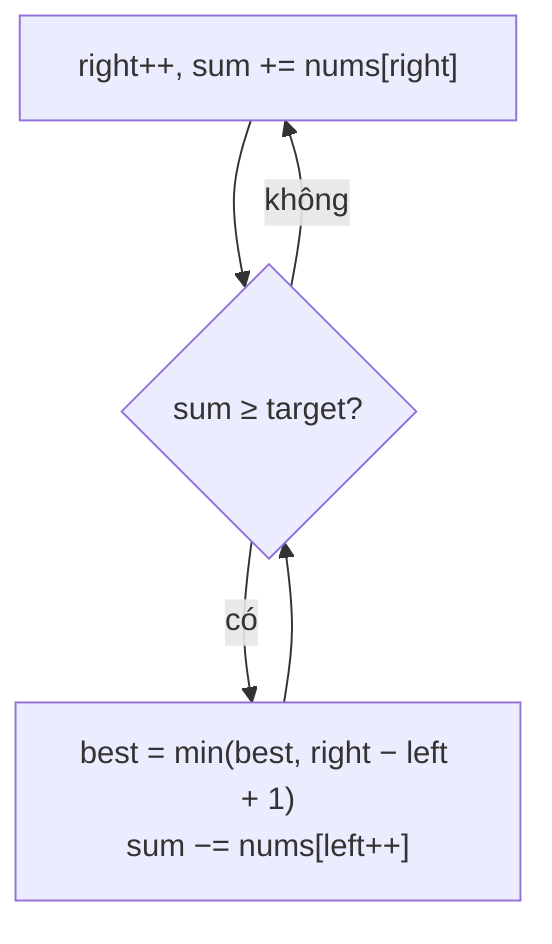

<!-- approaches: Brute force · Sliding window · Prefix sums + binary search -->
# 209. Minimum Size Subarray Sum

**Medium** · Array · Binary Search · Sliding Window · Prefix Sum · [LeetCode ↗](https://leetcode.com/problems/minimum-size-subarray-sum/) · Code: [MinimumSizeSubarraySum.java](MinimumSizeSubarraySum.java) · Tests: [MinimumSizeSubarraySumTest.java](MinimumSizeSubarraySumTest.java)

## Đề bài

Mảng số **dương** và `target`. Tìm độ dài **nhỏ nhất** của đoạn con liên tiếp có tổng `≥ target` (không có → 0).

```
target = 7, [2,3,1,2,4,3] -> 2   ([4,3])
```

## Ý tưởng

> Số **dương** nên: nới cửa sổ sang phải thì tổng **tăng**, co từ trái thì tổng **giảm**. Đây là điều kiện để dùng **cửa sổ trượt co giãn**:
> mở rộng `right` tới khi đủ tổng, rồi **co `left` hết mức** trong khi vẫn đủ — ghi lại độ dài nhỏ nhất.

| right | thêm | tổng | co left | độ dài tốt nhất |
|---|---|---|---|---|
| 3 | 2 | 8 | bỏ 2 → 6 | 4 |
| 4 | 4 | 10 | bỏ 3 → 7, bỏ 1 → 6 | 3 |
| 5 | 3 | 9 | bỏ 2 → 7, bỏ 4 → 3 | **2** |



## Cách 1 — Vét cạn `O(n²)`

## Cách 2 — Cửa sổ trượt `O(n)` ⭐

Dù có vòng `while` lồng nhau, mỗi phần tử vào cửa sổ một lần và ra một lần → `O(n)`.

## Cách 3 — Prefix sum + tìm kiếm nhị phân `O(n log n)` (follow-up)

Prefix sum của số dương là dãy **tăng ngặt** → với mỗi điểm đầu `i`, tìm nhị phân điểm cuối đầu tiên có `prefix ≥ prefix[i] + target`.

## Bẫy & lưu ý

- Có **số âm** thì cửa sổ trượt **sai** (co lại có thể làm tổng tăng) → cần deque đơn điệu trên prefix sum (bài 862, Hard).

## Bài liên quan

3 Longest Substring Without Repeating Characters · 862 Shortest Subarray with Sum at Least K (Hard) · 713 Subarray Product Less Than K · 1004 Max Consecutive Ones III.
