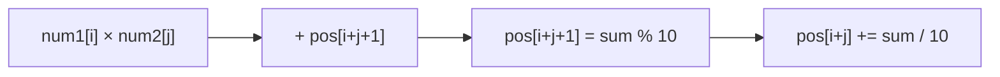

<!-- approaches: Grade-school multiplication into a digit array -->
# 43. Multiply Strings

**Medium** · Math · String · Simulation · [LeetCode ↗](https://leetcode.com/problems/multiply-strings/) · Code: [MultiplyStrings.java](MultiplyStrings.java) · Tests: [MultiplyStringsTest.java](MultiplyStringsTest.java)

## Đề bài

Nhân hai số nguyên không âm cho dưới dạng chuỗi, không dùng `BigInteger`.

```
"123" × "456" -> "56088"
```

## Ý tưởng

> Nhân tay kiểu tiểu học, nhưng **cộng dồn ngay vào một mảng** thay vì cộng các dòng trung gian.
> Chữ số `num1[i]` × `num2[j]` rơi vào vị trí **`i + j + 1`** (hàng đơn vị) và **`i + j`** (số nhớ) của kết quả dài `m + n`.

```
        1 2 3        i
      × 4 5 6        j
  3×6 = 18 → pos[2+2+1] = 8, nhớ 1 vào pos[4]
  …
  pos = [0 5 6 0 8 8] → "56088"
```



## Lời giải `O(m·n)` ⭐

Kết quả nhiều nhất `m + n` chữ số. Bỏ các số 0 ở đầu; toàn 0 thì trả `"0"`.

## Bài liên quan

415 Add Strings · 67 Add Binary · 2 Add Two Numbers · 989 Add to Array-Form of Integer.
