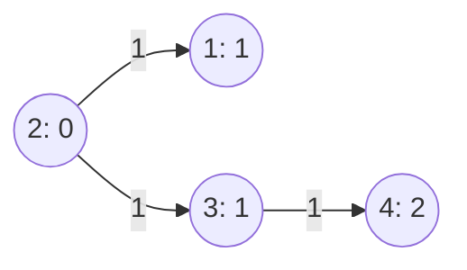

<!-- approaches: Dijkstra with a heap · Bellman-Ford · BFS relaxation (SPFA) -->
# 743. Network Delay Time

**Medium** · Depth-First Search · Breadth-First Search · Graph Theory · Heap (Priority Queue) · [LeetCode ↗](https://leetcode.com/problems/network-delay-time/) · Code: [NetworkDelayTime.java](NetworkDelayTime.java) · Tests: [NetworkDelayTimeTest.java](NetworkDelayTimeTest.java)

## Đề bài

Đồ thị có hướng, có trọng số (thời gian truyền). Phát tín hiệu từ đỉnh `k`: sau bao lâu **mọi** đỉnh đều nhận được? Có đỉnh không nhận được → `−1`.

```
2 →(1) 1
2 →(1) 3 →(1) 4         k = 2 -> 2
```

## Ý tưởng

> Thời gian một đỉnh nhận tín hiệu = **đường đi ngắn nhất** từ `k`. Đáp án = đường ngắn nhất **dài nhất** trong số đó.
> Trọng số không âm → **Dijkstra**: luôn "chốt" đỉnh gần nhất chưa chốt; một đỉnh khi đã chốt thì không thể có đường ngắn hơn.



| lấy ra khỏi heap | khoảng cách | đẩy vào |
|---|---|---|
| 2 | 0 | (1, 1), (3, 1) |
| 1 | 1 | |
| 3 | 1 | (4, 2) |
| 4 | 2 | → max = **2** |

## Cách 1 — Dijkstra + heap `O(E log E)` ⭐

"Chốt lười": đẩy cả bản ghi cũ vào heap, khi lấy ra mà đỉnh đã chốt thì bỏ qua — đơn giản hơn cập nhật khoá trong heap.

## Cách 2 — Bellman–Ford `O(n·E)`

Thả lỏng **mọi cạnh** `n − 1` lần (đường ngắn nhất có tối đa `n − 1` cạnh). Chậm hơn nhưng chạy được với **trọng số âm** và phát hiện được chu trình âm.

## Cách 3 — SPFA

Bellman–Ford dùng hàng đợi: chỉ thả lỏng lại các cạnh đi ra từ đỉnh vừa được cải thiện. Thường nhanh, xấu nhất vẫn `O(n·E)`.

## Khi nào dùng thuật toán nào

| Đồ thị | Thuật toán |
|---|---|
| Không trọng số | BFS |
| Trọng số 0/1 | BFS với deque (0-1 BFS) |
| Trọng số không âm | Dijkstra |
| Có trọng số âm | Bellman–Ford |
| Mọi cặp đỉnh, n nhỏ | Floyd–Warshall |

## Bài liên quan

787 Cheapest Flights Within K Stops · 1631 Path With Minimum Effort · 1514 Path with Maximum Probability · 778 Swim in Rising Water (Hard).
