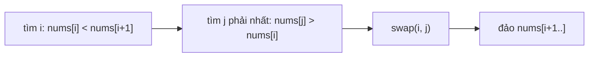

<!-- approaches: Find the pivot, swap with the next larger, reverse the suffix -->
# 31. Next Permutation

**Medium** · Array · Two Pointers · [LeetCode ↗](https://leetcode.com/problems/next-permutation/) · Code: [NextPermutation.java](NextPermutation.java) · Tests: [NextPermutationTest.java](NextPermutationTest.java)

## Đề bài

Biến `nums` thành **hoán vị kế tiếp** theo thứ tự từ điển (sửa tại chỗ). Nếu đã là lớn nhất thì quay về nhỏ nhất.

```
[1,2,3] -> [1,3,2]      [3,2,1] -> [1,2,3]      [1,3,5,4,2] -> [1,4,2,3,5]
```

## Ý tưởng — ba bước

> 1. Từ phải sang, tìm `i` đầu tiên có `nums[i] < nums[i+1]` — **điểm xoay**. Phần sau `i` đang **giảm dần** (đã là lớn nhất có thể).
> 2. Trong phần sau, tìm số **nhỏ nhất lớn hơn `nums[i]`** (là số tận cùng bên phải lớn hơn nó) và **đổi chỗ**.
> 3. **Đảo ngược** phần sau `i` để nó thành tăng dần (nhỏ nhất).

```
1 3 [5 4 2]     phần sau giảm dần; điểm xoay i = 1 (giá trị 3)
1 4 [5 3 2]     đổi 3 với 4 (số nhỏ nhất > 3 ở bên phải)
1 4 [2 3 5]     đảo phần sau
```



## Lời giải `O(n) · O(1)` ⭐

Không có điểm xoay (`i = −1`, cả mảng giảm dần) → chỉ đảo cả mảng. Dùng `>=` / `<=` để xử lý số trùng (`[1,5,1]` → `[5,1,1]`).

Test: từ mảng tăng dần gọi liên tục phải đi qua đúng `5!/2! = 60` hoán vị khác nhau, mỗi lần lớn hơn lần trước, rồi quay về đầu.

## Bài liên quan

46 Permutations · 60 Permutation Sequence · 556 Next Greater Element III · 1850 Minimum Adjacent Swaps to Reach the Kth Smallest Number.
