<!-- approaches: Greedy by end time · DP by start time (O(n²)) -->
# 435. Non-overlapping Intervals

**Medium** · Array · Dynamic Programming · Greedy · Sorting · [LeetCode ↗](https://leetcode.com/problems/non-overlapping-intervals/) · Code: [NonOverlappingIntervals.java](NonOverlappingIntervals.java) · Tests: [NonOverlappingIntervalsTest.java](NonOverlappingIntervalsTest.java)

## Đề bài

Xoá **ít khoảng nhất** để các khoảng còn lại không chồng nhau (chạm đầu mút như `[1,2]` và `[2,3]` thì không tính là chồng).

```
[[1,2],[2,3],[3,4],[1,3]] -> 1   (xoá [1,3])
```

## Ý tưởng

> Xoá ít nhất ⇔ **giữ nhiều nhất**. Đây là bài **lập lịch khoảng** kinh điển: sắp xếp theo **thời điểm kết thúc**, luôn chọn khoảng **kết thúc sớm nhất** còn tương thích — nó để lại nhiều chỗ nhất cho các khoảng sau.

```mermaid
gantt
    dateFormat X
    axisFormat %s
    section giữ
    [1,2] :done, 1, 2
    [2,3] :done, 2, 3
    [3,4] :done, 3, 4
    section xoá
    [1,3] :crit, 1, 3
```



| khoảng (theo end) | lastEnd | giữ? |
|---|---|---|
| [1,2] | −∞ | ✓ → 2 |
| [2,3] | 2 | ✓ (2 ≥ 2) → 3 |
| [1,3] | 3 | ✗ (1 < 3) |
| [3,4] | 3 | ✓ → 4 |

Giữ 3, xoá **1**.

## Cách 1 — Tham lam theo điểm kết thúc `O(n log n)` ⭐

**Vì sao đúng?** Trong một cách giữ tối ưu, thay khoảng đầu tiên bằng khoảng kết thúc sớm nhất: không làm chồng thêm khoảng nào (vì nó kết thúc còn sớm hơn), số khoảng giữ nguyên → vẫn tối ưu. Lặp lại cho phần còn lại.

## Cách 2 — DP `O(n²)`

Sắp xếp theo điểm bắt đầu; `dp[i]` = số khoảng không chồng nhiều nhất kết thúc bằng khoảng `i` (giống LIS). Dùng làm chuẩn để test.

## Bẫy & lưu ý

- Sắp xếp theo **start** rồi tham lam cũng làm được, nhưng khi chồng nhau phải giữ khoảng có **end nhỏ hơn** — dễ sai hơn.

## Bài liên quan

452 Minimum Number of Arrows to Burst Balloons (gần như giống hệt) · 56 Merge Intervals · 253 Meeting Rooms II · 1235 Maximum Profit in Job Scheduling (Hard, có trọng số).
