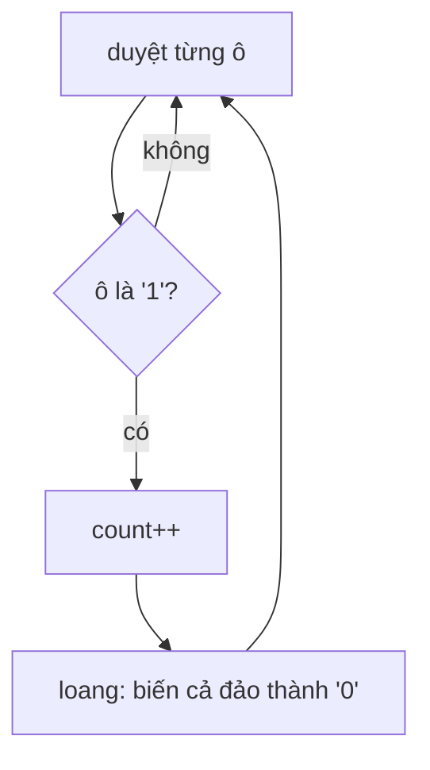

<!-- approaches: DFS flood fill · BFS flood fill · Union-find -->
# 200. Number of Islands

**Medium** · Array · Depth-First Search · Breadth-First Search · Union-Find · [LeetCode ↗](https://leetcode.com/problems/number-of-islands/) · Code: [NumberOfIslands.java](NumberOfIslands.java) · Tests: [NumberOfIslandsTest.java](NumberOfIslandsTest.java)

## Đề bài

Lưới `'1'` (đất) và `'0'` (nước). Đếm số **đảo** (nhóm ô đất nối nhau theo 4 hướng).

```
1 1 0 0 0
1 1 0 0 0      -> 3
0 0 1 0 0
0 0 0 1 1
```

## Ý tưởng

> Đếm số **thành phần liên thông** trên lưới. Mỗi ô đất **chưa thăm** là điểm bắt đầu của một đảo mới → đếm +1, rồi **loang** đánh dấu toàn bộ đảo để không đếm lại.



## Cách 1 — DFS loang ⭐

Bài flood fill kinh điển — cùng khuôn với 695 Max Area of Island (đếm đảo thay vì đo diện tích).

## Cách 2 — BFS loang

Tránh đệ quy sâu. Đánh dấu khi **đưa vào** hàng đợi.

## Cách 3 — Union-Find

Ban đầu mỗi ô đất là một đảo (`count` = số ô đất). Mỗi lần hợp nhất hai ô **thuộc hai tập khác nhau** → `count−−`. Ưu điểm: hỗ trợ **thêm đất dần dần** và trả lời số đảo sau mỗi lần thêm (bài 305).

## Độ phức tạp

`O(m · n)` thời gian cho cả ba.

## Bài liên quan

695 Max Area of Island · 463 Island Perimeter · 130 Surrounded Regions · 547 Number of Provinces · 1254 Number of Closed Islands.
