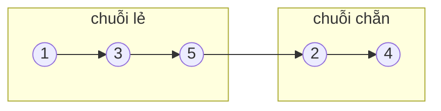

<!-- approaches: Two chains in one pass · Collect and relink -->
# 328. Odd Even Linked List

**Medium** · Linked List · [LeetCode ↗](https://leetcode.com/problems/odd-even-linked-list/) · Code: [OddEvenLinkedList.java](OddEvenLinkedList.java) · Tests: [OddEvenLinkedListTest.java](OddEvenLinkedListTest.java)

## Đề bài

Gom các node ở vị trí **lẻ** (thứ 1, 3, 5…) lên trước, các node ở vị trí **chẵn** ra sau, giữ thứ tự tương đối. Bộ nhớ `O(1)`.

```
1 → 2 → 3 → 4 → 5   =>   1 → 3 → 5 → 2 → 4
```

## Ý tưởng

> Đi một lượt, tách thành **hai chuỗi**: chuỗi lẻ và chuỗi chẵn (mỗi node "nhảy cóc" qua một node để nối với node cùng loại kế tiếp). Cuối cùng nối đuôi chuỗi lẻ với đầu chuỗi chẵn.



## Cách 1 — Gom node rồi nối lại `O(n)` bộ nhớ

## Cách 2 — Hai chuỗi trong một lượt `O(1)` ⭐

Mỗi vòng: `odd.next = even.next` (node lẻ kế), `even.next = odd.next` (node chẵn kế). Dừng khi `even` hoặc `even.next` là `null`. Nhớ lưu `evenHead` để nối vào cuối.

## Bẫy & lưu ý

- "Lẻ/chẵn" là **vị trí**, không phải giá trị.

## Bài liên quan

86 Partition List (tách theo giá trị) · 143 Reorder List · 2 Add Two Numbers.
