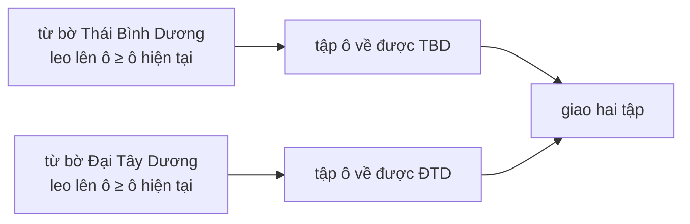

<!-- approaches: Reverse DFS from both oceans · Reverse BFS from both oceans -->
# 417. Pacific Atlantic Water Flow

**Medium** · Array · Depth-First Search · Breadth-First Search · Matrix · [LeetCode ↗](https://leetcode.com/problems/pacific-atlantic-water-flow/) · Code: [PacificAtlanticWaterFlow.java](PacificAtlanticWaterFlow.java) · Tests: [PacificAtlanticWaterFlowTest.java](PacificAtlanticWaterFlowTest.java)

## Đề bài

Hòn đảo dạng lưới độ cao. **Thái Bình Dương** giáp cạnh trên và trái, **Đại Tây Dương** giáp cạnh dưới và phải. Nước chảy sang ô kề có độ cao **bằng hoặc thấp hơn**. Tìm các ô mà nước chảy được ra **cả hai** đại dương.

## Ý tưởng

> Kiểm tra từ **từng ô** xem chảy ra biển được không thì tốn `O((m·n)²)`. **Nghĩ ngược lại**: từ bờ biển, đi **ngược dòng** (sang ô cao hơn hoặc bằng). Mọi ô đi tới được đều chảy về biển đó.
> Làm hai lần (mỗi đại dương một lần), lấy **giao**.



```
  ~ ~ ~ ~ ~ ~ ~          P = Thái Bình Dương (trên, trái)
~ 1  2  2  3 [5] *       A = Đại Tây Dương (dưới, phải)
~ 3  2  3 [4][4] *       [ ] = về được cả hai
~ 2  4 [5] 3  1  *
~[6][7] 1  4  5  *
~[5] 1  1  2  4  *
  * * * * * * *
```

## Cách 1 — DFS ngược từ hai bờ `O(m·n)` ⭐

Mỗi ô được thăm tối đa một lần cho mỗi đại dương.

## Cách 2 — BFS đa nguồn

Đưa **tất cả ô bờ** của một đại dương vào hàng đợi cùng lúc, rồi loang. Kỹ thuật **multi-source BFS** dùng lại ở 994 Rotting Oranges, 542 01 Matrix, 286 Walls and Gates.

## Bài liên quan

200 Number of Islands · 130 Surrounded Regions (cũng loang ngược từ biên) · 994 Rotting Oranges · 542 01 Matrix.
