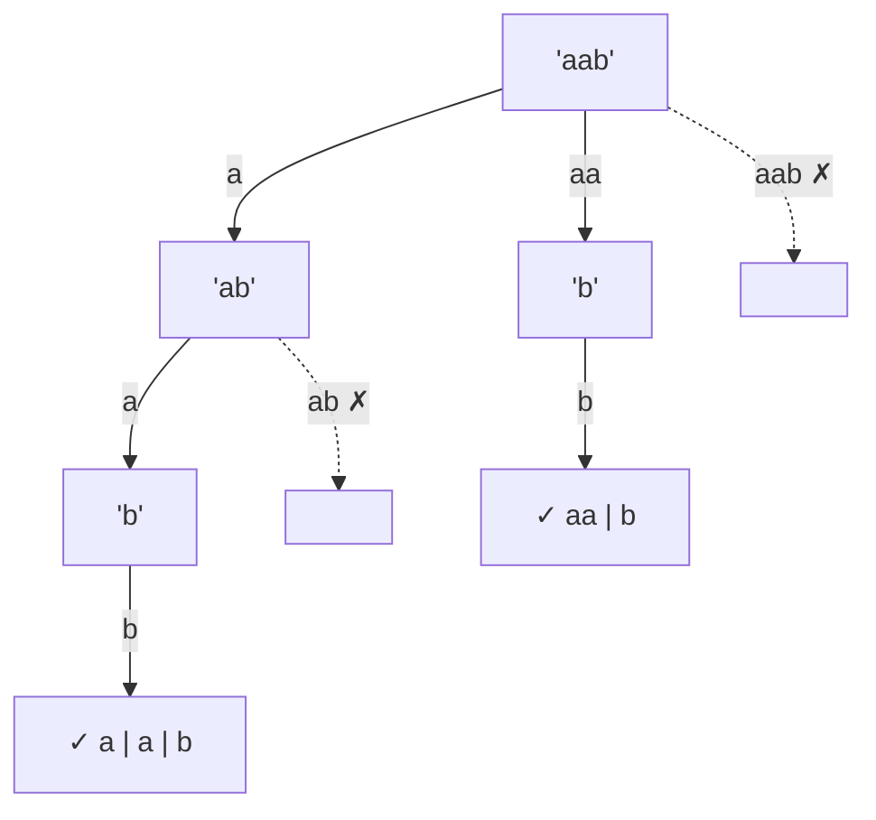

<!-- approaches: Backtracking with palindrome check · Backtracking with precomputed DP table -->
# 131. Palindrome Partitioning

**Medium** · String · Dynamic Programming · Backtracking · [LeetCode ↗](https://leetcode.com/problems/palindrome-partitioning/) · Code: [PalindromePartitioning.java](PalindromePartitioning.java) · Tests: [PalindromePartitioningTest.java](PalindromePartitioningTest.java)

## Đề bài

Chia chuỗi thành các đoạn sao cho **mỗi đoạn đều đối xứng**. Liệt kê mọi cách chia.

```
"aab" -> [a, a, b], [aa, b]
```

## Ý tưởng

> Chọn **đoạn đầu tiên** là một tiền tố đối xứng, rồi giải tiếp phần còn lại — backtracking trên **vị trí cắt**.



## Cách 1 — Backtracking + kiểm tra hai con trỏ

Mỗi lần thử đoạn `[start, end]` thì kiểm tra đối xứng `O(n)`.

## Cách 2 — Bảng đối xứng tính trước ⭐

`isPal[i][j] = s[i] == s[j] && (j − i < 2 || isPal[i+1][j−1])` (như bài 5). Điền `i` **từ cuối lên** để `isPal[i+1][…]` đã có sẵn. Mỗi lần kiểm tra còn `O(1)`.

## Độ phức tạp

Trường hợp xấu nhất (`"aaaa…"`) mọi vị trí cắt đều hợp lệ → `2ⁿ⁻¹` cách chia, mỗi cách dài tới `n` → `O(n · 2ⁿ)`.

## Bài liên quan

132 Palindrome Partitioning II (Hard, số lần cắt ít nhất — DP) · 5 Longest Palindromic Substring · 93 Restore IP Addresses (cùng kiểu backtracking trên vị trí cắt).
