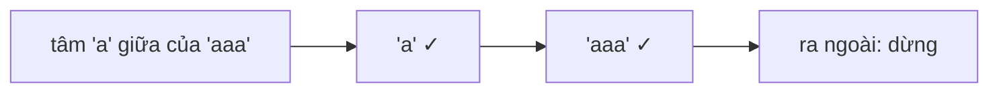

<!-- approaches: Brute force · Expand around centers · DP table -->
# 647. Palindromic Substrings

**Medium** · Two Pointers · String · Dynamic Programming · [LeetCode ↗](https://leetcode.com/problems/palindromic-substrings/) · Code: [PalindromicSubstrings.java](PalindromicSubstrings.java) · Tests: [PalindromicSubstringsTest.java](PalindromicSubstringsTest.java)

## Đề bài

Đếm số **chuỗi con đối xứng** (cùng nội dung nhưng khác vị trí vẫn tính riêng).

```
"aaa" -> 6:  a, a, a, aa, aa, aaa
```

## Ý tưởng

> Giống 5 Longest Palindromic Substring, nhưng thay vì tìm dài nhất thì **đếm**: mỗi lần nở thêm thành công từ một tâm là **thêm một** chuỗi đối xứng.



| tâm (trong "aaa") | chuỗi đếm được |
|---|---|
| a₀ | a |
| khe a₀a₁ | aa |
| a₁ | a, aaa |
| khe a₁a₂ | aa |
| a₂ | a |
| | **tổng 6** |

## Cách 1 — Vét cạn `O(n³)`

## Cách 2 — Nở từ `2n − 1` tâm `O(n²) · O(1)` ⭐

Một vòng lặp duy nhất qua `center = 0 … 2n−2`: `l = center / 2`, `r = l + center % 2` — tâm chẵn là ký tự, tâm lẻ là khe.

## Cách 3 — Bảng DP `O(n²) · O(n²)`

Đếm số ô `true` của bảng `pal[i][j]`.

## Bài liên quan

5 Longest Palindromic Substring · 516 Longest Palindromic Subsequence · 131 Palindrome Partitioning.
