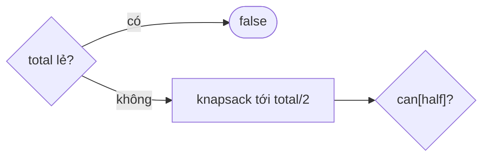

<!-- approaches: 0/1 knapsack boolean DP · Bitset shift -->
# 416. Partition Equal Subset Sum

**Medium** · Array · Dynamic Programming · Knapsack Problem · 0-1 Knapsack · [LeetCode ↗](https://leetcode.com/problems/partition-equal-subset-sum/) · Code: [PartitionEqualSubsetSum.java](PartitionEqualSubsetSum.java) · Tests: [PartitionEqualSubsetSumTest.java](PartitionEqualSubsetSumTest.java)

## Đề bài

Chia mảng thành hai phần có **tổng bằng nhau** được không?

```
[1,5,11,5] -> true   ([1,5,5] và [11])
[1,2,3,5]  -> false
```

## Ý tưởng

> Hai phần bằng nhau ⇔ có một tập con tổng đúng **`total / 2`** (tổng lẻ thì chắc chắn không). Đây là **knapsack 0/1 dạng true/false**.

`can[s]` = có tập con tổng `s`. Thêm số `x`: `can[s] |= can[s − x]`, duyệt `s` **giảm dần** để mỗi số chỉ dùng một lần.

`[1,5,11,5]`, half = 11:

| sau số | tổng đạt được |
|---|---|
| 1 | 0, 1 |
| 5 | 0, 1, 5, 6 |
| 11 | 0, 1, 5, 6, **11** ✓ |



## Cách 1 — DP boolean `O(n · total)` ⭐

Duyệt `s` **tăng dần** là sai: số `x` sẽ bị cộng nhiều lần (thành bài knapsack không giới hạn).

## Cách 2 — Bitset

Bit thứ `s` bật ⇔ đạt được tổng `s`. Thêm `x`: `bits |= bits << x` — xử lý 64 tổng một lúc.

## Bài liên quan

494 Target Sum · 698 Partition to K Equal Sum Subsets · 1049 Last Stone Weight II · 2035 Partition Array Into Two Arrays to Minimize Sum Difference.
