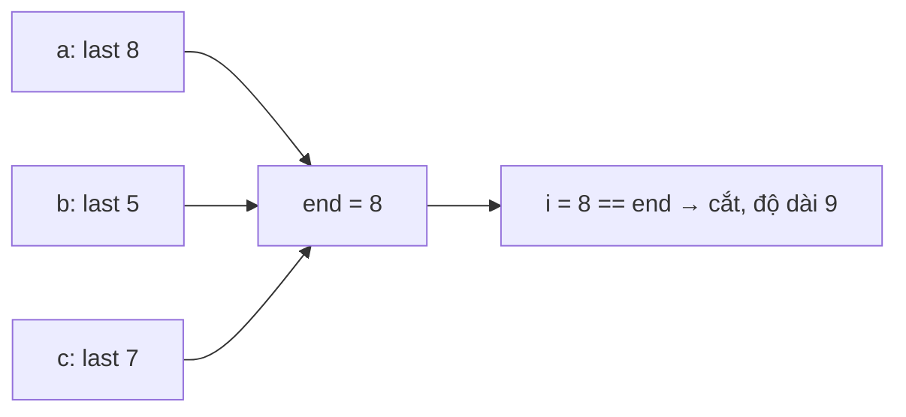

<!-- approaches: Last occurrence + greedy cut · Merge intervals -->
# 763. Partition Labels

**Medium** · Hash Table · Two Pointers · String · Greedy · [LeetCode ↗](https://leetcode.com/problems/partition-labels/) · Code: [PartitionLabels.java](PartitionLabels.java) · Tests: [PartitionLabelsTest.java](PartitionLabelsTest.java)

## Đề bài

Chia chuỗi thành **nhiều phần nhất** sao cho mỗi chữ cái chỉ xuất hiện trong **một** phần. Trả về độ dài các phần.

```
"ababcbacadefegdehijhklij" -> [9, 7, 8]
 ababcbaca | defegde | hijhklij
```

## Ý tưởng

> Phần chứa chữ `c` phải kéo dài **ít nhất tới lần xuất hiện cuối** của `c`. Đi từ trái sang, liên tục nới `end` = lần xuất hiện cuối xa nhất của các chữ đã gặp. Khi `i` chạm `end` → mọi chữ trong phần đều đã "khép lại" → **cắt**.



| i | chữ | last | end |
|---|---|---|---|
| 0 | a | 8 | 8 |
| 1 | b | 5 | 8 |
| 4 | c | 7 | 8 |
| 8 | a | 8 | 8 → **cắt** (9) |
| 9 | d | 14 | 14 |
| 10 | e | 15 | 15 |
| 15 | e | 15 | 15 → **cắt** (7) |

## Cách 1 — Lần xuất hiện cuối + tham lam `O(n)` ⭐

Cắt **sớm nhất có thể** luôn cho nhiều phần nhất: cắt muộn hơn chỉ gộp phần.

## Cách 2 — Gộp khoảng

Mỗi chữ chiếm khoảng `[đầu, cuối]`. Các khoảng chồng nhau phải chung một phần → gộp khoảng (bài 56). Cùng đáp án, nhưng thấy rõ bài này **là** bài merge intervals.

## Bài liên quan

56 Merge Intervals · 55 Jump Game (cùng kiểu "nới biên xa nhất") · 3 Longest Substring Without Repeating Characters.
