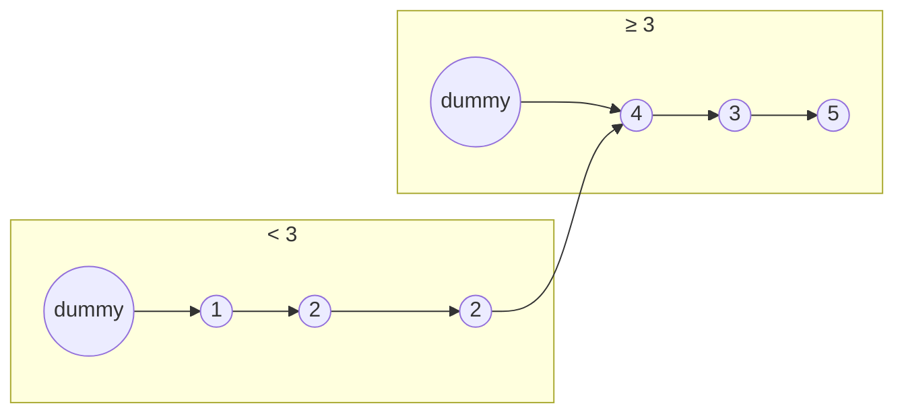

<!-- approaches: Two dummy lists · Collect values -->
# 86. Partition List

**Medium** · Linked List · Two Pointers · [LeetCode ↗](https://leetcode.com/problems/partition-list/) · Code: [PartitionList.java](PartitionList.java) · Tests: [PartitionListTest.java](PartitionListTest.java)

## Đề bài

Sắp lại danh sách sao cho mọi node `< x` đứng trước mọi node `≥ x`, **giữ nguyên thứ tự** trong mỗi phần.

```
1 → 4 → 3 → 2 → 5 → 2,  x = 3   =>   1 → 2 → 2 → 4 → 3 → 5
```

## Ý tưởng

> Đi một lượt, đưa từng node vào **một trong hai danh sách** (nhỏ / lớn), mỗi danh sách có node giả riêng. Cuối cùng nối danh sách nhỏ với danh sách lớn. Thứ tự tự nhiên được giữ vì ta chỉ nối vào cuối.



## Cách 1 — Hai danh sách với node giả ⭐

**Bẫy quan trọng:** phải đặt `after.next = null`. Node lớn cuối cùng có thể vẫn trỏ tới một node nhỏ phía sau trong danh sách gốc → tạo **chu trình**.

## Cách 2 — Ghi lại giá trị

Gom giá trị, ghi các giá trị nhỏ trước rồi giá trị lớn. Đúng, nhưng đổi giá trị chứ không đổi node — thường không được chấp nhận.

## Bài liên quan

328 Odd Even Linked List · 75 Sort Colors (phân hoạch trên mảng) · 2161 Partition Array According to Given Pivot.
