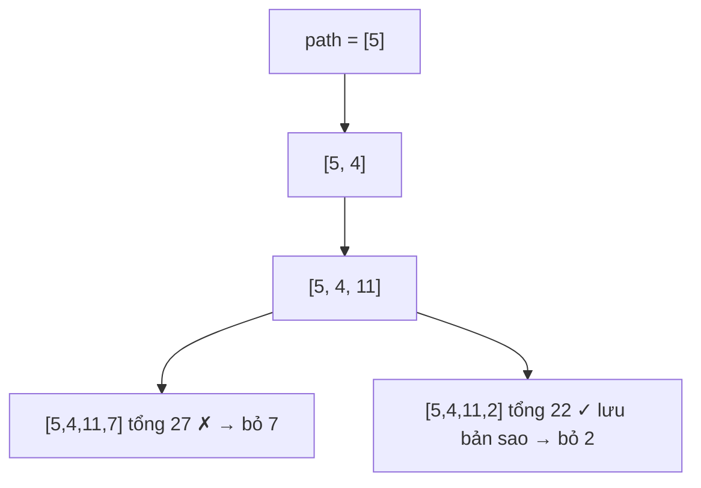

<!-- approaches: DFS with backtracking · BFS with paths -->
# 113. Path Sum II

**Medium** · Backtracking · Tree · Depth-First Search · Binary Tree · [LeetCode ↗](https://leetcode.com/problems/path-sum-ii/) · Code: [PathSumII.java](PathSumII.java) · Tests: [PathSumIITest.java](PathSumIITest.java)

## Đề bài

Liệt kê **mọi** đường từ gốc tới lá có tổng bằng `targetSum`.

```
          5
         / \
        4   8
       /   / \
      11  13  4        target = 22 -> [5,4,11,2], [5,8,4,5]
     /  \    / \
    7    2  5   1
```

## Ý tưởng

> Như 112 Path Sum, nhưng thay vì trả `true/false` thì phải **giữ lại đường đi**. Dùng một danh sách `path` chung: thêm node khi đi xuống, **bỏ ra** khi quay lên (backtracking).



## Cách 1 — DFS + backtracking ⭐

- Lưu **bản sao** `new ArrayList<>(path)` vào kết quả — `path` sẽ còn bị sửa.
- `path.removeLast()` đặt ở **cuối** hàm, chạy cho mọi nhánh (kể cả lá).

## Cách 2 — BFS mang theo đường đi

Mỗi phần tử hàng đợi mang theo cả danh sách đường đi → tốn bộ nhớ hơn, nhưng không cần hoàn tác.

## Độ phức tạp

`O(n²)` trường hợp xấu (cây gần như danh sách, nhiều đường thoả mãn, mỗi lần sao chép `O(n)`).

## Bài liên quan

112 Path Sum · 437 Path Sum III · 257 Binary Tree Paths · 39 Combination Sum (cùng khuôn backtracking).
