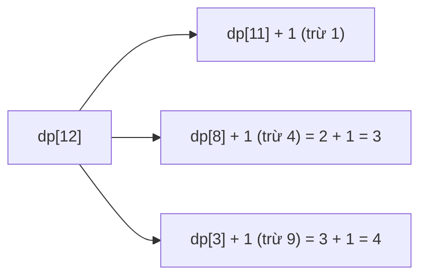

<!-- approaches: DP over n · BFS over remainders · Number theory (Lagrange / Legendre) -->
# 279. Perfect Squares

**Medium** · Math · Dynamic Programming · Breadth-First Search · Knapsack Problem · [LeetCode ↗](https://leetcode.com/problems/perfect-squares/) · Code: [PerfectSquares.java](PerfectSquares.java) · Tests: [PerfectSquaresTest.java](PerfectSquaresTest.java)

## Đề bài

Số **ít nhất** các số chính phương (1, 4, 9, 16, …) có tổng bằng `n`.

```
12 -> 3   (4 + 4 + 4)        13 -> 2   (4 + 9)
```

## Ý tưởng

> Giống **Coin Change** với các "đồng xu" là số chính phương: `dp[i] = 1 + min(dp[i − s²])`.

| i | 1 | 2 | 3 | 4 | 5 | … | 12 | 13 |
|---|---|---|---|---|---|---|---|---|
| dp | 1 | 2 | 3 | 1 | 2 | | 3 | 2 |



## Cách 1 — DP `O(n√n)` ⭐

## Cách 2 — BFS

Mỗi đỉnh là "phần còn lại", mỗi cạnh trừ đi một số chính phương. Tầng đầu tiên chạm `0` là đáp án. Thường nhanh hơn DP vì dừng sớm.

## Cách 3 — Lý thuyết số `O(√n)`

- **Định lý Lagrange**: mọi số nguyên dương là tổng của **tối đa 4** số chính phương.
- **Định lý Legendre**: cần **đúng 4** ⇔ `n` có dạng `4ᵃ(8b + 7)`.
- Còn lại: kiểm tra 1 (chính `n` là số chính phương) và 2 (thử mọi `s`); không thì là 3.

Không cần nhớ chứng minh — nhưng nhắc tới khi phỏng vấn là điểm cộng lớn.

## Bài liên quan

322 Coin Change · 279 là ví dụ BFS trên "không gian trạng thái số" · 204 Count Primes.
