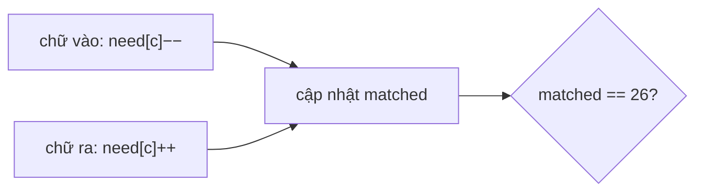

<!-- approaches: Fixed window with letter counts and a match counter -->
# 567. Permutation in String

**Medium** · Hash Table · Two Pointers · String · Sliding Window · [LeetCode ↗](https://leetcode.com/problems/permutation-in-string/) · Code: [PermutationInString.java](PermutationInString.java) · Tests: [PermutationInStringTest.java](PermutationInStringTest.java)

## Đề bài

`s2` có chứa một **hoán vị** của `s1` làm chuỗi con liên tiếp không?

```
("ab", "eidbaooo") -> true   ("ba")
```

## Ý tưởng

> Hoán vị = **cùng bảng đếm chữ cái**. Trượt cửa sổ dài `|s1|` trên `s2`; mỗi lần dời chỉ có **hai chữ cái** thay đổi số đếm (một vào, một ra).
> Thay vì so cả 26 ô mỗi bước, giữ biến `matched` = số chữ cái có số đếm khớp. `matched == 26` ⇔ cửa sổ là hoán vị.

```
s1 = "ab"
eidbaooo
  [db]     d thừa, a thiếu
   [ba]    khớp ✓
```



## Lời giải — Cửa sổ cố định `O(|s2|)` ⭐

`need[c]` = số lần trong `s1` trừ số lần trong cửa sổ. Hàm `change` trả về `matched` tăng hay giảm khi một ô đi qua / rời khỏi giá trị 0.

## Bài liên quan

438 Find All Anagrams in a String (cùng kỹ thuật, trả về mọi vị trí) · 76 Minimum Window Substring · 242 Valid Anagram.
