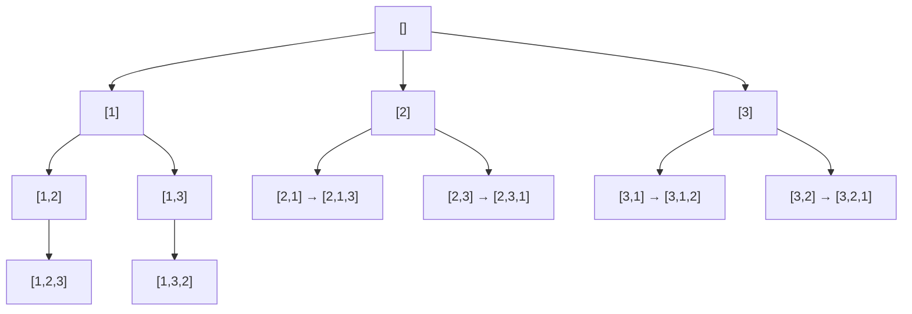

<!-- approaches: Backtracking with used[] · Backtracking by swapping · Insert into every position -->
# 46. Permutations

**Medium** · Array · Backtracking · [LeetCode ↗](https://leetcode.com/problems/permutations/) · Code: [Permutations.java](Permutations.java) · Tests: [PermutationsTest.java](PermutationsTest.java)

## Đề bài

Liệt kê **mọi hoán vị** của một mảng các số khác nhau.

```
[1,2,3] -> [1,2,3] [1,3,2] [2,1,3] [2,3,1] [3,1,2] [3,2,1]     (3! = 6)
```

## Ý tưởng

> Điền từng **vị trí**: vị trí 1 có `n` lựa chọn, vị trí 2 còn `n − 1`… Khác Subsets ở chỗ mọi phần tử **chưa dùng** đều được chọn (không chỉ phần tử phía sau), nên cần đánh dấu `used`.



## Cách 1 — Backtracking với `used[]` ⭐

Khuôn chuẩn: chọn → đánh dấu → đệ quy → bỏ chọn → bỏ đánh dấu. Cho kết quả theo **thứ tự từ điển** nếu mảng đã sắp xếp.

## Cách 2 — Hoán đổi tại chỗ

Để chốt vị trí `k`, lần lượt đổi từng phần tử `a[i]` (`i ≥ k`) vào vị trí `k`, đệ quy cho `k + 1`, rồi đổi lại. Không cần `used` hay `path` — phần `a[0..k)` chính là đường đi.

## Cách 3 — Chèn vào mọi khe

Từ các hoán vị của `k` số, chèn số thứ `k+1` vào **mọi khe** (`k + 1` khe) của mỗi hoán vị.

| sau khi xét | hoán vị |
|---|---|
| 1 | [1] |
| 2 | [2,1] [1,2] |
| 3 | [3,2,1] [2,3,1] [2,1,3] [3,1,2] [1,3,2] [1,2,3] |

## Độ phức tạp

`O(n · n!)` — có `n!` hoán vị, mỗi cái dài `n`.

## Bài liên quan

47 Permutations II (có trùng) · 31 Next Permutation · 60 Permutation Sequence (Hard) · 78 Subsets.
