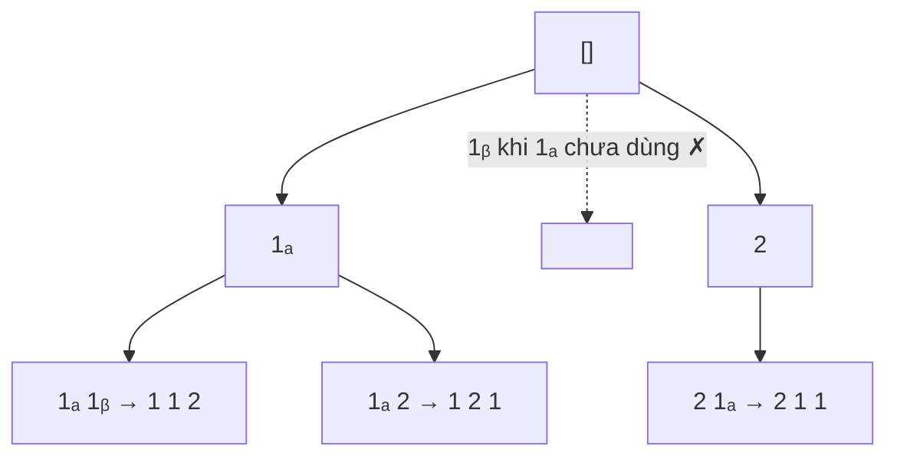

<!-- approaches: Backtracking with used[] and skip rule · Count map -->
# 47. Permutations II

**Medium** · Array · Backtracking · Sorting · [LeetCode ↗](https://leetcode.com/problems/permutations-ii/) · Code: [PermutationsII.java](PermutationsII.java) · Tests: [PermutationsIITest.java](PermutationsIITest.java)

## Đề bài

Liệt kê mọi hoán vị **không trùng nhau** của một mảng **có thể có phần tử lặp**.

```
[1,1,2] -> [1,1,2] [1,2,1] [2,1,1]     (không phải 3! = 6)
```

## Ý tưởng

> Hai số `1` giống nhau nên hoán vị `1ₐ 1ᵦ 2` và `1ᵦ 1ₐ 2` là **một**. Quy ước: trong các giá trị bằng nhau, luôn dùng theo **thứ tự trái → phải**. Sau khi sắp xếp, `a[i]` chỉ được chọn nếu bản giống nó đứng trước (`a[i−1]`) **đã được dùng**.



## Cách 1 — Backtracking + quy tắc bỏ qua ⭐

Điều kiện bỏ qua: `i > 0 && a[i] == a[i−1] && !used[i−1]`. Thiếu bước **sắp xếp** thì các giá trị bằng nhau không đứng cạnh nhau, quy tắc không hoạt động.

## Cách 2 — Chọn theo bảng đếm

Mỗi tầng chọn một **giá trị khác nhau** còn số lượng > 0. Vì không bao giờ chọn cùng một giá trị hai lần ở cùng một tầng, không thể sinh trùng — dễ thuyết phục người phỏng vấn hơn.

## Bài liên quan

46 Permutations · 90 Subsets II · 40 Combination Sum II (cùng quy tắc bỏ qua phần tử trùng).
