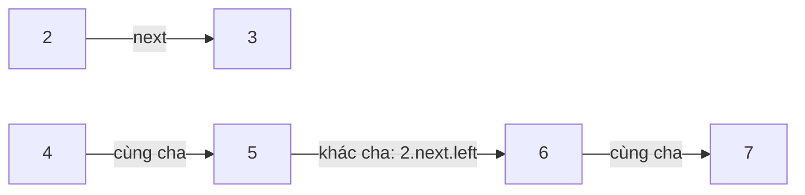

<!-- approaches: BFS by levels · Use the next pointers of the level above · Recursive -->
# 116. Populating Next Right Pointers in Each Node

**Medium** · Linked List · Tree · Depth-First Search · Breadth-First Search · [LeetCode ↗](https://leetcode.com/problems/populating-next-right-pointers-in-each-node/) · Code: [PopulatingNextRightPointersInEachNode.java](PopulatingNextRightPointersInEachNode.java) · Tests: [PopulatingNextRightPointersInEachNodeTest.java](PopulatingNextRightPointersInEachNodeTest.java)

## Đề bài

Cây nhị phân **hoàn hảo** (mọi tầng đều đầy). Gán con trỏ `next` của mỗi node trỏ tới node **bên phải cùng tầng** (cuối tầng → `null`). Follow-up: bộ nhớ `O(1)`.

```
        1 → null
      /   \
     2  →  3 → null
    / \   / \
   4→ 5 → 6→ 7 → null
```

## Ý tưởng

> Khi tầng trên **đã nối xong**, nó trở thành một danh sách liên kết — đi dọc nó để nối tầng dưới, không cần hàng đợi.
> Với mỗi node của tầng trên, có hai loại liên kết cho tầng dưới:
> 1. **cùng cha**: `node.left.next = node.right`
> 2. **khác cha**: `node.right.next = node.next.left`



## Cách 1 — BFS theo tầng `O(n)` · bộ nhớ `O(chiều rộng)`

Nối mỗi node với node lấy ra ngay sau nó trong cùng tầng.

## Cách 2 — Dùng `next` của tầng trên `O(1)` ⭐

Hai vòng lặp: ngoài đi xuống theo `leftmost`, trong đi ngang theo `next`.

## Cách 3 — Đệ quy

Cùng hai liên kết, viết đệ quy (stack `O(log n)` không tính vào yêu cầu).

## Bài liên quan

117 Populating Next Right Pointers II (cây **bất kỳ** — cần node giả cho tầng dưới) · 102 Level Order Traversal · 199 Right Side View.
