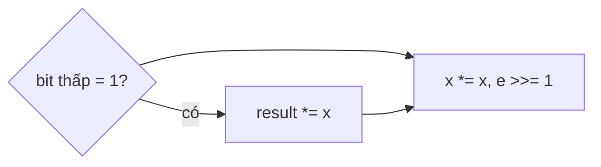

<!-- approaches: Fast exponentiation (iterative binary) · Recursive halving -->
# 50. Pow(x, n)

**Medium** · Math · Recursion · [LeetCode ↗](https://leetcode.com/problems/powx-n/) · Code: [PowXN.java](PowXN.java) · Tests: [PowXNTest.java](PowXNTest.java)

## Đề bài

Cài đặt `pow(x, n)` với `x` thực và `n` nguyên 32-bit (có thể âm).

```
(2.0, 10) -> 1024      (2.0, −2) -> 0.25
```

## Ý tưởng — luỹ thừa nhanh

> Nhân `x` lặp `n` lần là `O(n)` — `n` tới 2·10⁹ thì quá chậm. Dùng **biểu diễn nhị phân của `n`**:
> `x¹³ = x⁸ · x⁴ · x¹` (vì 13 = 1101₂). Lần lượt bình phương `x → x² → x⁴ → x⁸…`, nhân vào kết quả khi bit tương ứng bằng 1.

| bit của 13 | x hiện tại | nhân vào? | kết quả |
|---|---|---|---|
| 1 | x | ✓ | x |
| 0 | x² | | x |
| 1 | x⁴ | ✓ | x⁵ |
| 1 | x⁸ | ✓ | x¹³ |



## Cách 1 — Lặp theo bit `O(log n)` ⭐

**Bẫy:** `n = Integer.MIN_VALUE` thì `−n` tràn `int` → chuyển sang `long` trước khi đổi dấu. `n < 0` → tính `(1/x)^|n|`.

## Cách 2 — Đệ quy chia đôi

`xⁿ = (x^(n/2))²`, nhân thêm `x` nếu `n` lẻ. Chỉ gọi đệ quy **một** lần mỗi tầng (gọi hai lần `pow(x, n/2)` sẽ thành `O(n)`).

## Bài liên quan

372 Super Pow · 1922 Count Good Numbers · 509 Fibonacci Number (luỹ thừa ma trận) · 69 Sqrt(x).
