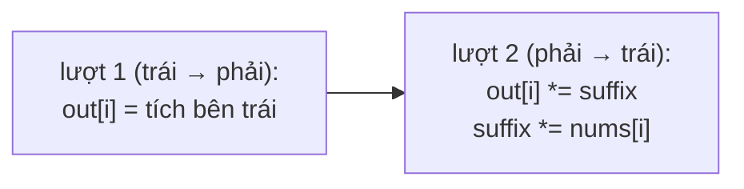

<!-- approaches: Prefix and suffix arrays · Output array + running suffix · Division (with zero handling) -->
# 238. Product of Array Except Self

**Medium** · Array · Prefix Sum · [LeetCode ↗](https://leetcode.com/problems/product-of-array-except-self/) · Code: [ProductOfArrayExceptSelf.java](ProductOfArrayExceptSelf.java) · Tests: [ProductOfArrayExceptSelfTest.java](ProductOfArrayExceptSelfTest.java)

## Đề bài

`answer[i]` = tích mọi phần tử **trừ** `nums[i]`. Yêu cầu `O(n)`, **không dùng phép chia**. Follow-up: `O(1)` bộ nhớ phụ.

```
[1,2,3,4] -> [24,12,8,6]
```

## Ý tưởng

> Tích "trừ `nums[i]`" = (tích mọi phần tử **bên trái** `i`) × (tích mọi phần tử **bên phải** `i`).
> Cả hai đều là **tích tiền tố / hậu tố** — tính được trong một lượt mỗi chiều.

| i | 0 | 1 | 2 | 3 |
|---|---|---|---|---|
| nums | 1 | 2 | 3 | 4 |
| tích bên trái | 1 | 1 | 2 | 6 |
| tích bên phải | 24 | 12 | 4 | 1 |
| **kết quả** | 24 | 12 | 8 | 6 |



## Cách 1 — Hai mảng trái/phải `O(n) · O(n)`

## Cách 2 — Dùng mảng kết quả + một biến `O(n) · O(1)` ⭐

Lượt 1 ghi tích bên trái vào `out`. Lượt 2 đi từ phải sang, giữ `suffix` = tích bên phải, nhân vào `out[i]`.

## Cách 3 — Phép chia (tham khảo)

Tích toàn mảng chia `nums[i]` — đề cấm, và phải xử lý số `0`:

| số lượng số 0 | kết quả |
|---|---|
| ≥ 2 | toàn 0 |
| 1 | chỉ vị trí của số 0 có giá trị (= tích các số còn lại) |
| 0 | `product / nums[i]` |

Người phỏng vấn hay hỏi "nếu được chia thì sao?" để xem bạn có nghĩ tới số 0 không.

## Bài liên quan

42 Trapping Rain Water (cùng ý tưởng trái/phải) · 152 Maximum Product Subarray · 303 Range Sum Query · 724 Find Pivot Index.
