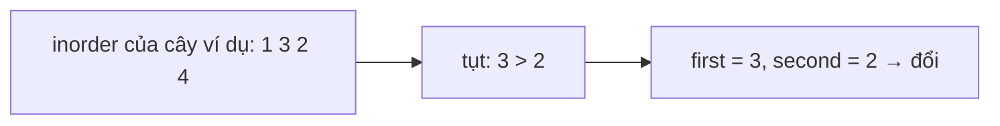

<!-- approaches: Inorder to list + sort values · Inorder finding the two swapped nodes · Morris inorder (O(1)) -->
# 99. Recover Binary Search Tree

**Medium** · Tree · Depth-First Search · Binary Search Tree · Binary Tree · [LeetCode ↗](https://leetcode.com/problems/recover-binary-search-tree/) · Code: [RecoverBinarySearchTree.java](RecoverBinarySearchTree.java) · Tests: [RecoverBinarySearchTreeTest.java](RecoverBinarySearchTreeTest.java)

## Đề bài

Đúng **hai node** của một BST bị đổi giá trị cho nhau. Khôi phục cây mà không đổi cấu trúc. Follow-up: bộ nhớ `O(1)`.

```
    3              2
   / \            / \
  1   4    ->    1   4
     /              /
    2              3
```

## Ý tưởng

> Inorder của BST đúng là dãy **tăng dần**. Đổi chỗ hai phần tử trong dãy tăng sẽ tạo ra **một hoặc hai chỗ "tụt"** (`trước > sau`):
> - Phần tử sai **thứ nhất** = `prev` ở chỗ tụt **đầu tiên**.
> - Phần tử sai **thứ hai** = `curr` ở chỗ tụt **cuối cùng**.

```
 hai phần tử xa nhau:  1 [6] 3 4 5 [2] 7    tụt ở 6>3 và 5>2  -> đổi 6 và 2
 hai phần tử liền kề:  1 2 [4][3] 5         chỉ tụt ở 4>3     -> đổi 4 và 3
```



## Cách 1 — Duyệt ra danh sách, sắp xếp giá trị, ghi lại `O(n log n)`

Đúng cho mọi trường hợp nhưng chậm và tốn bộ nhớ.

## Cách 2 — Inorder tìm hai node `O(n) · O(h)` ⭐

Một lượt inorder giữ `prev`; ở mỗi chỗ tụt: nếu `first` chưa có thì gán `first = prev`; luôn gán `second = curr`. Xong thì đổi giá trị hai node.

## Cách 3 — Morris inorder `O(1)` bộ nhớ

Cùng logic, nhưng duyệt bằng Morris (bài 94) — không stack, không đệ quy.

## Bài liên quan

98 Validate Binary Search Tree · 94 Inorder Traversal · 530 Minimum Absolute Difference in BST.
