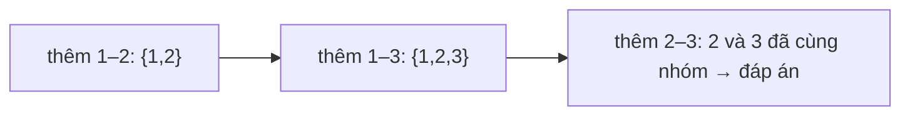

<!-- approaches: DFS check before each edge · Union-find -->
# 684. Redundant Connection

**Medium** · Depth-First Search · Breadth-First Search · Union-Find · Graph Theory · [LeetCode ↗](https://leetcode.com/problems/redundant-connection/) · Code: [RedundantConnection.java](RedundantConnection.java) · Tests: [RedundantConnectionTest.java](RedundantConnectionTest.java)

## Đề bài

Một cây `n` đỉnh bị thêm **một cạnh**. Tìm cạnh có thể bỏ để đồ thị lại thành cây; nếu nhiều cạnh thoả mãn, trả cạnh xuất hiện **cuối cùng** trong input.

```
[[1,2],[1,3],[2,3]] -> [2,3]
```

## Ý tưởng

> Thêm cạnh theo thứ tự. Cạnh **đầu tiên nối hai đỉnh đã liên thông với nhau** sẽ tạo chu trình — và vì nó là cạnh cuối cùng của chu trình được thêm vào, nó chính là đáp án "xuất hiện cuối cùng".
> "Hai đỉnh đã cùng một nhóm chưa?" là câu hỏi của **Union-Find**.



## Cách 1 — DFS trước mỗi cạnh `O(n²)`

Trước khi thêm `(u, v)`, kiểm tra xem `v` đã đi tới được từ `u` chưa.

## Cách 2 — Union-Find `≈ O(n)` ⭐

Hai thao tác:

| thao tác | ý nghĩa | tối ưu |
|---|---|---|
| `find(x)` | đại diện (gốc) của nhóm chứa `x` | **nén đường đi**: cho mọi node trên đường trỏ thẳng lên gốc |
| `union(a, b)` | gộp hai nhóm | **hợp theo hạng**: gắn cây thấp vào cây cao |

Với cả hai tối ưu, mỗi thao tác gần như `O(1)` (hàm Ackermann ngược `α(n)` ≤ 4 với mọi `n` thực tế).

## Bài liên quan

685 Redundant Connection II (Hard, đồ thị có hướng) · 547 Number of Provinces · 721 Accounts Merge · 1584 Min Cost to Connect All Points (Kruskal).
