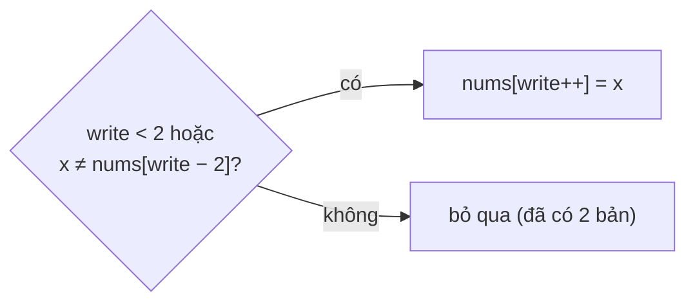

<!-- approaches: Count run lengths · Compare with the element two back -->
# 80. Remove Duplicates from Sorted Array II

**Medium** · Array · Two Pointers · [LeetCode ↗](https://leetcode.com/problems/remove-duplicates-from-sorted-array-ii/) · Code: [RemoveDuplicatesFromSortedArrayII.java](RemoveDuplicatesFromSortedArrayII.java) · Tests: [RemoveDuplicatesFromSortedArrayIITest.java](RemoveDuplicatesFromSortedArrayIITest.java)

## Đề bài

Mảng đã sắp xếp; xoá tại chỗ để mỗi giá trị xuất hiện **tối đa hai lần**. Trả về độ dài mới.

```
[1,1,1,2,2,3] -> 5, [1,1,2,2,3]
```

## Ý tưởng

> Một phần tử được giữ nếu nó **khác** phần tử đã ghi cách nó **hai ô** về trước. Nếu bằng, thì đã có hai bản giống nó liền trước rồi (mảng đã sắp xếp).



| x | phần đã ghi | nums[write−2] | giữ? |
|---|---|---|---|
| 1 | | – | ✓ |
| 1 | 1 | – | ✓ |
| 1 | 1 1 | 1 | ✗ |
| 2 | 1 1 | 1 | ✓ |
| 2 | 1 1 2 | 1 | ✓ |
| 3 | 1 1 2 2 | 2 | ✓ |

## Cách 1 — Đếm độ dài dãy lặp

## Cách 2 — So với phần tử cách hai ô ⭐

Tổng quát "giữ tối đa `k` bản": so với `nums[write − k]` (bài 26 là `k = 1`).

## Bài liên quan

26 Remove Duplicates from Sorted Array · 27 Remove Element · 283 Move Zeroes.
