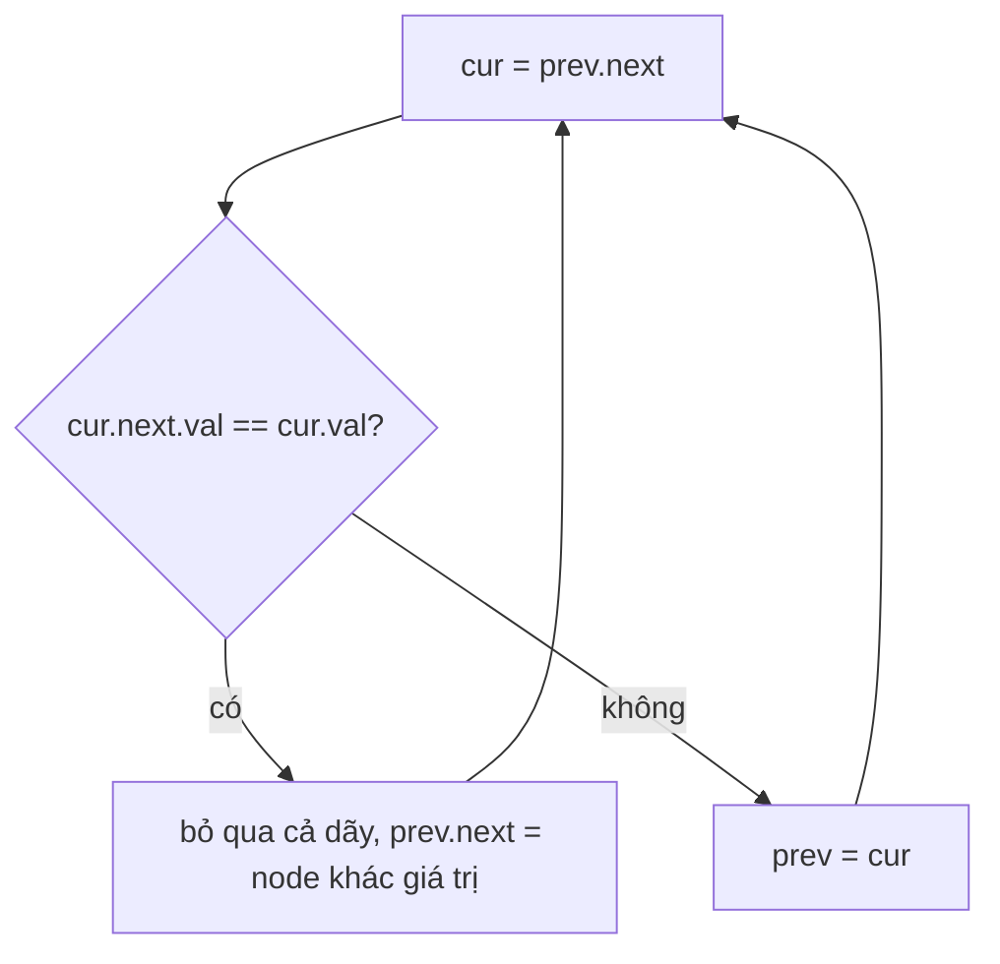

<!-- approaches: Dummy head + skip whole runs · Recursive -->
# 82. Remove Duplicates from Sorted List II

**Medium** · Linked List · Two Pointers · [LeetCode ↗](https://leetcode.com/problems/remove-duplicates-from-sorted-list-ii/) · Code: [RemoveDuplicatesFromSortedListII.java](RemoveDuplicatesFromSortedListII.java) · Tests: [RemoveDuplicatesFromSortedListIITest.java](RemoveDuplicatesFromSortedListIITest.java)

## Đề bài

Danh sách liên kết đã sắp xếp. Xoá **toàn bộ** các node có giá trị bị lặp — chỉ giữ giá trị xuất hiện đúng một lần.

```
1 → 2 → 3 → 3 → 4 → 4 → 5   ->   1 → 2 → 5
```

Khác bài 83 (giữ lại một bản): ở đây giá trị lặp bị **xoá sạch**.

## Ý tưởng

> `prev` = node cuối cùng **chắc chắn được giữ**. Nhìn `cur = prev.next`: nếu `cur` trùng với node sau nó → bỏ qua **cả dãy** cùng giá trị, nối `prev` thẳng tới node khác giá trị đầu tiên. Ngược lại → `prev` tiến lên.
> `dummy` cần thiết vì chính `head` có thể bị xoá (`[1,1,2]`).



## Cách 1 — Dummy + bỏ cả dãy `O(n) · O(1)` ⭐

## Cách 2 — Đệ quy

## Bài liên quan

83 Remove Duplicates from Sorted List · 26 Remove Duplicates from Sorted Array · 1836 Remove Duplicates From an Unsorted Linked List.
