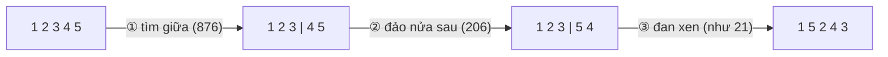

<!-- approaches: List of nodes + two pointers · Split, reverse, merge (O(1) space) -->
# 143. Reorder List

**Medium** · Linked List · Two Pointers · Stack · Recursion · [LeetCode ↗](https://leetcode.com/problems/reorder-list/) · Code: [ReorderList.java](ReorderList.java) · Tests: [ReorderListTest.java](ReorderListTest.java)

## Đề bài

Sắp xếp lại `L0 → L1 → … → Ln` thành `L0 → Ln → L1 → Ln−1 → L2 → …`, tại chỗ (đổi node, không đổi giá trị).

```
1 → 2 → 3 → 4 → 5   =>   1 → 5 → 2 → 4 → 3
```

## Ý tưởng

> Kết quả là hai nửa **đan xen**: nửa đầu đi xuôi, nửa sau đi **ngược**. Ba bước — mỗi bước là một bài easy đã biết:



## Cách 1 — Mảng node + hai con trỏ `O(n)` bộ nhớ

Lưu tham chiếu node, nối lần lượt từ hai đầu vào giữa. Nhớ đặt `next = null` cho node cuối để không tạo chu trình.

## Cách 2 — Tách, đảo, đan `O(1)` bộ nhớ ⭐

1. Con trỏ nhanh/chậm, dừng `slow` ở **cuối nửa đầu** (nửa đầu dài hơn khi `n` lẻ).
2. Đảo nửa sau, **cắt** `slow.next = null`.
3. Đan: lấy một node nửa đầu, một node nửa sau, lặp tới khi nửa sau hết.

| bước đan | first | second | danh sách |
|---|---|---|---|
| 1 | 1 | 5 | 1 → 5 → 2 … |
| 2 | 2 | 4 | 1 → 5 → 2 → 4 → 3 |
| 3 | 3 | null | dừng |

## Bài liên quan

234 Palindrome Linked List (cùng ba bước đầu) · 206 Reverse Linked List · 876 Middle of the Linked List · 21 Merge Two Sorted Lists.
