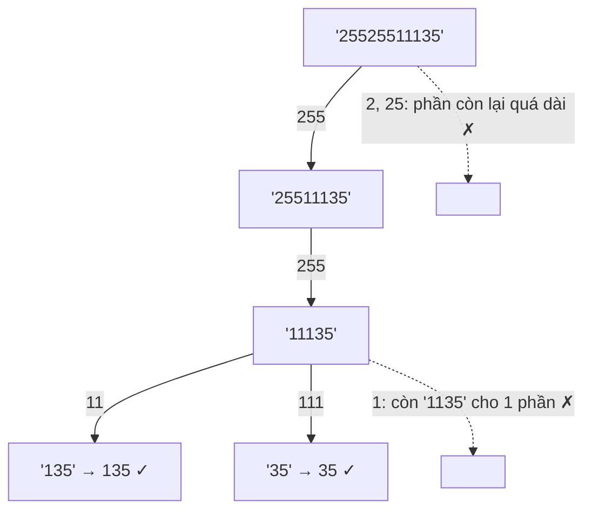

<!-- approaches: Backtracking over cut positions · Three nested loops -->
# 93. Restore IP Addresses

**Medium** · String · Backtracking · [LeetCode ↗](https://leetcode.com/problems/restore-ip-addresses/) · Code: [RestoreIPAddresses.java](RestoreIPAddresses.java) · Tests: [RestoreIPAddressesTest.java](RestoreIPAddressesTest.java)

## Đề bài

Chèn **ba dấu chấm** vào chuỗi chữ số để tạo mọi địa chỉ IPv4 hợp lệ. Mỗi phần trong `0..255`, **không có số 0 đứng đầu** (`"0"` hợp lệ, `"01"` không).

```
"25525511135" -> 255.255.11.135, 255.255.111.35
```

## Ý tưởng

> Bốn phần, mỗi phần dài 1–3 chữ số → backtracking chọn **độ dài** từng phần. Cắt tỉa mạnh: phần còn lại phải dài trong khoảng `[số phần còn lại, 3 × số phần còn lại]`.



## Cách 1 — Backtracking + cắt tỉa ⭐

## Cách 2 — Ba vòng lặp lồng nhau

Chỉ có ba vị trí cắt, mỗi vị trí cách vị trí trước 1–3 ký tự → tối đa `3³ = 27` tổ hợp. Đơn giản và thực tế còn nhanh hơn.

## Kiểm tra một phần hợp lệ

| phần | hợp lệ? | lý do |
|---|---|---|
| `0` | ✓ | |
| `01` | ✗ | số 0 đứng đầu |
| `255` | ✓ | |
| `256` | ✗ | > 255 |

## Bài liên quan

131 Palindrome Partitioning (cùng kiểu backtracking trên vị trí cắt) · 468 Validate IP Address · 93 là bài backtracking có độ sâu cố định.
