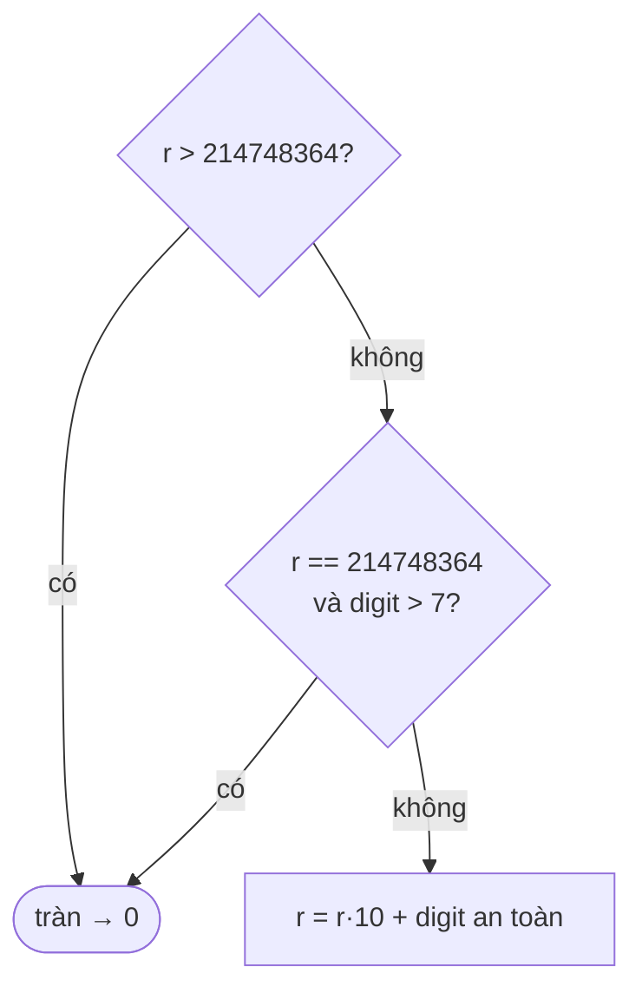

<!-- approaches: String · 64-bit check · 32-bit overflow guard -->
# 7. Reverse Integer

**Medium** · Math · [LeetCode ↗](https://leetcode.com/problems/reverse-integer/) · Code: [ReverseInteger.java](ReverseInteger.java) · Tests: [ReverseIntegerTest.java](ReverseIntegerTest.java)

## Đề bài

Đảo các chữ số của số nguyên 32-bit `x`. Nếu kết quả **tràn** khoảng `[−2³¹, 2³¹ − 1]` thì trả `0`. Không được dùng số 64-bit.

```
123 -> 321      -123 -> -321      120 -> 21      1534236469 -> 0 (9646324351 tràn)
```

## Ý tưởng

> Lấy chữ số cuối bằng `x % 10`, bỏ nó bằng `x / 10`, đẩy vào kết quả bằng `r = r·10 + digit`.
> Điểm khó duy nhất: **kiểm tra tràn trước khi nhân**, vì sau khi đã tràn thì không còn biết được nữa.

## Cách 1 — Qua chuỗi

Đảo chuỗi rồi `parseInt`; `NumberFormatException` nghĩa là tràn. Dễ, nhưng dùng exception để điều khiển luồng.

## Cách 2 — Dùng `long`

Dựng kết quả trong `long` rồi so với giới hạn `int`. Đúng, nhưng vi phạm ràng buộc "không 64-bit".

## Cách 3 — Chặn tràn bằng `int` ⭐

`Integer.MAX_VALUE = 2147483647`. Trước khi tính `r·10 + digit`:



Phía âm tương tự với `MIN_VALUE = −2147483648` (`digit < −8`).

| x còn lại | digit | r trước | r sau |
|---|---|---|---|
| −123 | −3 | 0 | −3 |
| −12 | −2 | −3 | −32 |
| −1 | −1 | −32 | −321 |

Trong Java, `−123 % 10 = −3` (dấu theo số bị chia) nên **không cần tách dấu** riêng.

## Bẫy & lưu ý

- `Math.abs(Integer.MIN_VALUE)` vẫn là số âm (tràn) — lý do cách 1 ép sang `long` trước.
- Thực ra với input là `int` hợp lệ, trường hợp `r == MAX/10` và `digit > 7` không thể xảy ra (chữ số đầu của `x` tối đa là 2), nhưng kiểm tra vẫn là cách trình bày chuẩn.

## Bài liên quan

8 String to Integer (atoi) · 9 Palindrome Number · 190 Reverse Bits.
