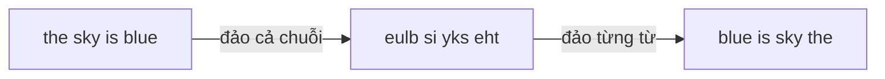

<!-- approaches: Split + reverse · Reverse whole then each word in a char array · Deque of words -->
# 151. Reverse Words in a String

**Medium** · Two Pointers · String · [LeetCode ↗](https://leetcode.com/problems/reverse-words-in-a-string/) · Code: [ReverseWordsInAString.java](ReverseWordsInAString.java) · Tests: [ReverseWordsInAStringTest.java](ReverseWordsInAStringTest.java)

## Đề bài

Đảo ngược **thứ tự các từ**. Kết quả chỉ có một dấu cách giữa các từ, không có dấu cách ở đầu/cuối.

```
"  hello world  "   -> "world hello"
"a good   example"  -> "example good a"
```

## Ý tưởng

> Cách gọn nhất trong Java: tách từ, đảo danh sách, nối lại. Nhưng câu hỏi tiếp theo thường là "**làm tại chỗ** (như C/C++ với chuỗi sửa được)" → mẹo **đảo hai lần**:
> đảo **cả chuỗi**, rồi đảo lại **từng từ**.



## Cách 1 — `split` + đảo + `join` ⭐ (trong Java)

`trim()` rồi `split("\\s+")` xử lý cả dấu cách thừa.

## Cách 2 — Đảo hai lần trên mảng ký tự

1. **Nén** dấu cách (bỏ đầu/cuối/lặp) bằng con trỏ ghi — như 27 Remove Element.
2. Đảo toàn bộ.
3. Đảo từng từ (như 557).

## Cách 3 — Deque

Đọc từng từ từ trái sang và đẩy vào **đầu** deque.

## Bẫy & lưu ý

- `split(" ")` (một dấu cách) sinh ra chuỗi rỗng khi có nhiều dấu cách liền nhau.

## Bài liên quan

557 Reverse Words in a String III · 186 Reverse Words in a String II · 189 Rotate Array (cũng dùng mẹo đảo ba lần).
