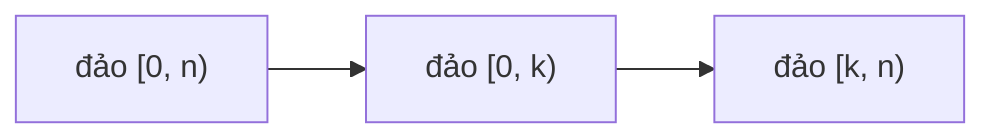

<!-- approaches: Three reversals · Cyclic replacements · Extra array -->
# 189. Rotate Array

**Medium** · Array · Math · Two Pointers · [LeetCode ↗](https://leetcode.com/problems/rotate-array/) · Code: [RotateArray.java](RotateArray.java) · Tests: [RotateArrayTest.java](RotateArrayTest.java)

## Đề bài

Xoay mảng sang phải `k` bước, tại chỗ. Follow-up: `O(1)` bộ nhớ.

```
[1,2,3,4,5,6,7], k = 3 -> [5,6,7,1,2,3,4]
```

## Ý tưởng — ba lần đảo ngược

> Xoay phải `k` = đưa `k` phần tử cuối lên đầu, giữ thứ tự. Đảo cả mảng thì `k` phần tử cuối lên đầu nhưng **bị ngược** → đảo lại từng phần.

```
1 2 3 4 5 6 7     ban đầu
7 6 5 4 3 2 1     đảo cả mảng
5 6 7 4 3 2 1     đảo k = 3 phần tử đầu
5 6 7 1 2 3 4     đảo n − k phần tử sau
```



## Cách 1 — Ba lần đảo `O(n) · O(1)` ⭐

Nhớ `k %= n` (k có thể lớn hơn n).

## Cách 2 — Chu trình

Đưa phần tử `i` tới `(i + k) % n`, mang phần tử bị đè đi tiếp… Có `gcd(n, k)` chu trình; đếm số phần tử đã dời để biết khi nào xong.

## Cách 3 — Mảng phụ `O(n)` bộ nhớ

## Bài liên quan

61 Rotate List · 186 Reverse Words in a String II · 796 Rotate String · 48 Rotate Image.
