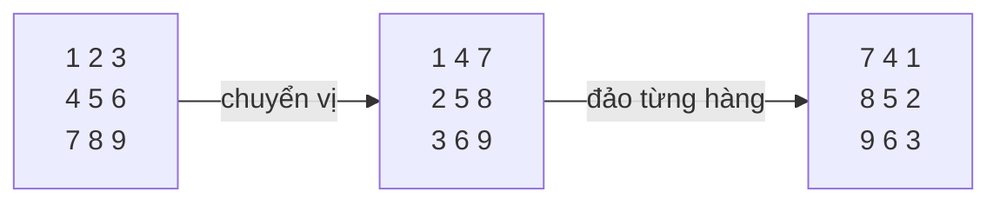

<!-- approaches: Extra matrix · Transpose + reverse rows · Rotate four cells at a time -->
# 48. Rotate Image

**Medium** · Array · Math · Matrix · [LeetCode ↗](https://leetcode.com/problems/rotate-image/) · Code: [RotateImage.java](RotateImage.java) · Tests: [RotateImageTest.java](RotateImageTest.java)

## Đề bài

Xoay ma trận vuông `n × n` **90° theo chiều kim đồng hồ**, **tại chỗ**.

```
1 2 3       7 4 1
4 5 6  ->   8 5 2
7 8 9       9 6 3
```

## Ý tưởng

> Xoay 90° = **chuyển vị** (lật qua đường chéo chính) rồi **lật ngang** từng hàng. Hai phép đơn giản, đều làm được tại chỗ.



Công thức: phần tử `(i, j)` tới `(j, n−1−i)`. Chuyển vị đưa `(i, j) → (j, i)`, đảo hàng đưa `(j, i) → (j, n−1−i)` ✓.

## Cách 1 — Ma trận phụ `O(n²)` bộ nhớ

Đúng nhưng vi phạm "tại chỗ".

## Cách 2 — Chuyển vị + đảo hàng ⭐

Khi chuyển vị chỉ đổi cặp với `j > i` (nửa trên đường chéo) — đổi cả ma trận sẽ đổi mỗi cặp **hai lần**, về như cũ.

## Cách 3 — Xoay bốn ô một lúc theo từng lớp

Mỗi lớp (vòng ngoài vào trong) có các nhóm 4 ô thay chỗ cho nhau theo vòng: trái → trên → phải → dưới → trái. Một biến tạm cho mỗi nhóm.

```
 lớp 0 của ma trận 4×4:
 a . . b        d . . a
 . . . .   ->   . . . .
 . . . .        . . . .
 d . . c        c . . b
```

## Biến thể

| Phép | Cách làm |
|---|---|
| Xoay 90° ngược chiều | chuyển vị + đảo từng **cột** (hoặc đảo hàng trước rồi chuyển vị) |
| Xoay 180° | đảo thứ tự hàng + đảo từng hàng |

## Bài liên quan

54 Spiral Matrix · 867 Transpose Matrix · 1886 Determine Whether Matrix Can Be Obtained By Rotation.
