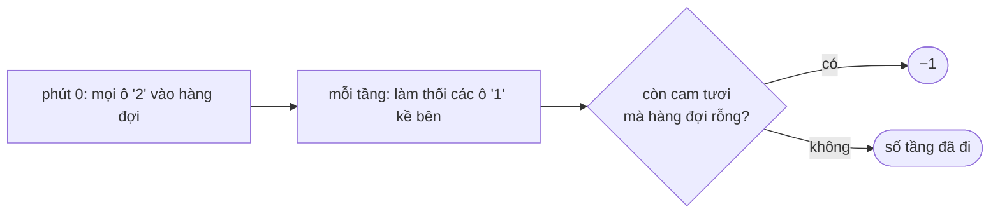

<!-- approaches: Multi-source BFS · Repeated simulation -->
# 994. Rotting Oranges

**Medium** · Array · Breadth-First Search · Matrix · [LeetCode ↗](https://leetcode.com/problems/rotting-oranges/) · Code: [RottingOranges.java](RottingOranges.java) · Tests: [RottingOrangesTest.java](RottingOrangesTest.java)

## Đề bài

Lưới: `0` trống, `1` cam tươi, `2` cam thối. Mỗi phút, cam tươi **kề** cam thối (4 hướng) bị thối theo. Sau bao nhiêu phút thì hết cam tươi? Không thể → `−1`.

```
2 1 1        2 2 1        2 2 2        2 2 2        2 2 2
1 1 0   ->   2 1 0   ->   2 2 0   ->   2 2 0   ->   2 2 0     4 phút
0 1 1        0 1 1        0 1 1        0 2 1        0 2 2
```

## Ý tưởng

> Thối lan ra **đồng thời** từ **mọi** quả thối, mỗi phút một bước → **BFS đa nguồn**: đưa tất cả cam thối ban đầu vào hàng đợi cùng lúc. Mỗi **tầng** BFS là một phút.



## Cách 1 — BFS đa nguồn `O(m·n)` ⭐

- Đếm số cam tươi trước; mỗi lần làm thối một quả thì giảm. Kết thúc mà còn > 0 → `−1`.
- Chỉ tăng phút khi **còn cam tươi** (điều kiện `fresh > 0` ở vòng `while`) — nếu không sẽ đếm thừa một phút cuối.

## Cách 2 — Mô phỏng từng phút

Mỗi phút quét cả lưới, tính trạng thái mới từ trạng thái cũ. Đơn giản nhưng chậm: `O((m·n)²)`.

## Bài liên quan

542 01 Matrix · 286 Walls and Gates · 1162 As Far from Land as Possible · 417 Pacific Atlantic Water Flow.
