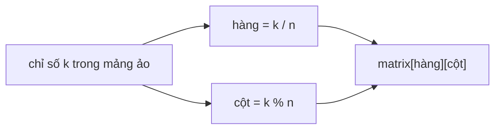

<!-- approaches: Binary search on rows then columns · One binary search over the flattened matrix -->
# 74. Search a 2D Matrix

**Medium** · Array · Binary Search · Matrix · [LeetCode ↗](https://leetcode.com/problems/search-a-2d-matrix/) · Code: [SearchA2DMatrix.java](SearchA2DMatrix.java) · Tests: [SearchA2DMatrixTest.java](SearchA2DMatrixTest.java)

## Đề bài

Mỗi hàng tăng dần, và phần tử đầu mỗi hàng lớn hơn phần tử cuối hàng trước. Có `target` không? Yêu cầu `O(log(m·n))`.

```
 1  3  5  7
10 11 16 20       target 3 -> true, target 13 -> false
23 30 34 60
```

## Ý tưởng

> Đọc ma trận theo từng hàng thì được **một mảng tăng dần** dài `m·n`. Phần tử thứ `k` của mảng ảo đó là `matrix[k / n][k % n]` → tìm kiếm nhị phân một lần.



| k | 0 | 1 | 2 | 3 | 4 | 5 | … |
|---|---|---|---|---|---|---|---|
| (hàng, cột) | 0,0 | 0,1 | 0,2 | 0,3 | 1,0 | 1,1 | |
| giá trị | 1 | 3 | 5 | 7 | 10 | 11 | |

## Cách 1 — Nhị phân hai bước

Tìm hàng cuối cùng có phần tử đầu `≤ target`, rồi tìm nhị phân trong hàng đó. `O(log m + log n)`.

## Cách 2 — Nhị phân trên mảng ảo `O(log(m·n))` ⭐

## Bẫy & lưu ý

- `m·n` có thể tràn `int` với ma trận rất lớn — ở đây tối đa 100 × 100 nên an toàn.

## Bài liên quan

240 Search a 2D Matrix II (điều kiện yếu hơn, dùng bậc thang) · 704 Binary Search · 378 Kth Smallest Element in a Sorted Matrix.
