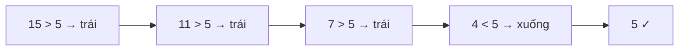

<!-- approaches: Binary search each row · Staircase from the top-right -->
# 240. Search a 2D Matrix II

**Medium** · Array · Binary Search · Divide and Conquer · Matrix · [LeetCode ↗](https://leetcode.com/problems/search-a-2d-matrix-ii/) · Code: [SearchA2DMatrixII.java](SearchA2DMatrixII.java) · Tests: [SearchA2DMatrixIITest.java](SearchA2DMatrixIITest.java)

## Đề bài

Ma trận mà mỗi **hàng** tăng dần từ trái sang và mỗi **cột** tăng dần từ trên xuống. Có `target` không?

```
 1  4  7 11 15
 2  5  8 12 19
 3  6  9 16 22      target 5 -> true, target 20 -> false
10 13 14 17 24
18 21 23 26 30
```

## Ý tưởng

> Đứng ở góc **trên phải**: đi trái thì nhỏ đi, đi xuống thì lớn lên — giống một **cây tìm kiếm nhị phân**.
> - Ô hiện tại **lớn hơn** target → mọi ô **bên dưới** trong cột này còn lớn hơn → bỏ cả cột, sang trái.
> - **Nhỏ hơn** → mọi ô **bên trái** trong hàng này còn nhỏ hơn → bỏ cả hàng, đi xuống.



## Cách 1 — Tìm nhị phân từng hàng `O(m log n)`

## Cách 2 — Bậc thang từ góc trên phải `O(m + n)` ⭐

Mỗi bước loại **một hàng hoặc một cột** → tối đa `m + n` bước. Góc dưới trái cũng dùng được (đối xứng); góc trên trái và dưới phải thì **không** (cả hai hướng đều tăng hoặc đều giảm).

## So với bài 74

| | 74 Search a 2D Matrix | 240 (bài này) |
|---|---|---|
| Thêm điều kiện | đầu hàng sau > cuối hàng trước | không |
| Tốt nhất | coi như mảng 1D, nhị phân `O(log mn)` | bậc thang `O(m + n)` |

## Bài liên quan

74 Search a 2D Matrix · 378 Kth Smallest Element in a Sorted Matrix · 1351 Count Negative Numbers in a Sorted Matrix.
