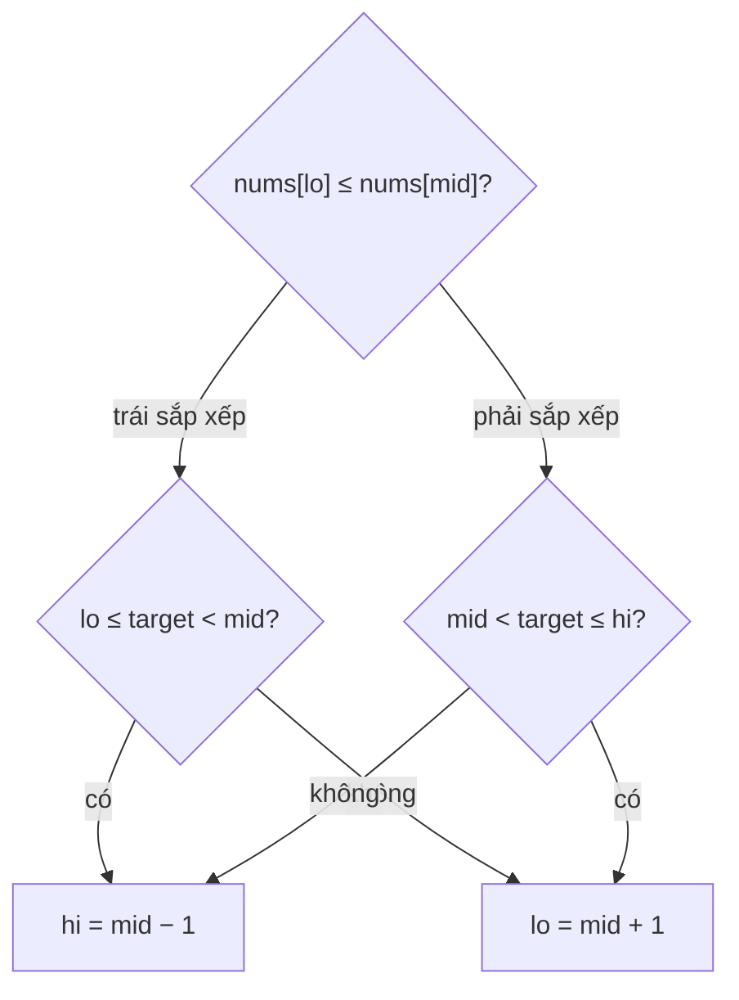

<!-- approaches: Binary search on the sorted half -->
# 33. Search in Rotated Sorted Array

**Medium** · Array · Binary Search · [LeetCode ↗](https://leetcode.com/problems/search-in-rotated-sorted-array/) · Code: [SearchInRotatedSortedArray.java](SearchInRotatedSortedArray.java) · Tests: [SearchInRotatedSortedArrayTest.java](SearchInRotatedSortedArrayTest.java)

## Đề bài

Mảng tăng dần (các số khác nhau) bị **xoay** tại một điểm không biết trước. Tìm `target` trong `O(log n)`.

```
[4,5,6,7,0,1,2], 0 -> 4
```

## Ý tưởng

> Chia đôi tại `mid` thì **ít nhất một nửa đã sắp xếp** (nửa không chứa điểm xoay). Kiểm tra nửa đó bằng `nums[lo] ≤ nums[mid]`.
> - Nếu `target` nằm **trong khoảng** của nửa đã sắp xếp → tìm ở đó.
> - Ngược lại → tìm ở nửa kia.

```
[4 5 6 7 | 0 1 2]   mid = 7, nửa trái [4..7] sắp xếp, target 0 không thuộc [4,7) → sang phải
[0 1 2]              mid = 1, nửa trái [0..1] sắp xếp, 0 thuộc [0,1) → sang trái → tìm thấy
```



## Lời giải `O(log n)` ⭐

Dùng `≤` trong `nums[lo] ≤ nums[mid]`: khi `lo == mid` (còn hai phần tử) nửa trái chỉ có một phần tử, vẫn coi là sắp xếp. Test thử **mọi** góc xoay và mọi `target`.

## Bài liên quan

81 Search in Rotated Sorted Array II (có trùng) · 153 Find Minimum in Rotated Sorted Array · 154 (có trùng, Hard) · 1095 Find in Mountain Array.
