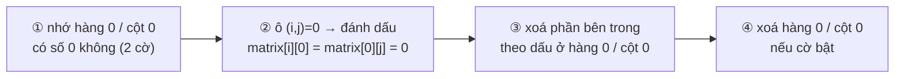

<!-- approaches: Row and column sets · First row/column as markers (O(1) space) -->
# 73. Set Matrix Zeroes

**Medium** · Array · Hash Table · Matrix · [LeetCode ↗](https://leetcode.com/problems/set-matrix-zeroes/) · Code: [SetMatrixZeroes.java](SetMatrixZeroes.java) · Tests: [SetMatrixZeroesTest.java](SetMatrixZeroesTest.java)

## Đề bài

Ô nào bằng 0 thì đặt **cả hàng và cả cột** của nó thành 0, tại chỗ. Follow-up: bộ nhớ `O(1)`.

```
0 1 2 0        0 0 0 0
3 4 5 2   ->   0 4 5 0
1 3 1 5        0 3 1 0
```

## Ý tưởng

> Không thể xoá ngay khi gặp số 0 — các số 0 mới tạo ra sẽ lan sai. Phải **ghi nhớ trước** hàng/cột nào cần xoá, rồi mới xoá.
> Để tiết kiệm bộ nhớ: dùng chính **hàng 0 và cột 0** làm sổ ghi nhớ.



## Cách 1 — Hai mảng đánh dấu `O(m + n)`

## Cách 2 — Dùng hàng/cột đầu làm sổ `O(1)` ⭐

Thứ tự là then chốt: hàng 0 và cột 0 phải xoá **sau cùng**, vì chúng đang chứa thông tin đánh dấu. Hai cờ `firstRow`, `firstCol` lưu lại việc chính hàng/cột đầu có số 0 ban đầu hay không.

## Bài liên quan

289 Game of Life (cùng mẹo lưu thông tin trong ma trận) · 48 Rotate Image · 2128 Remove All Ones With Row and Column Flips.
