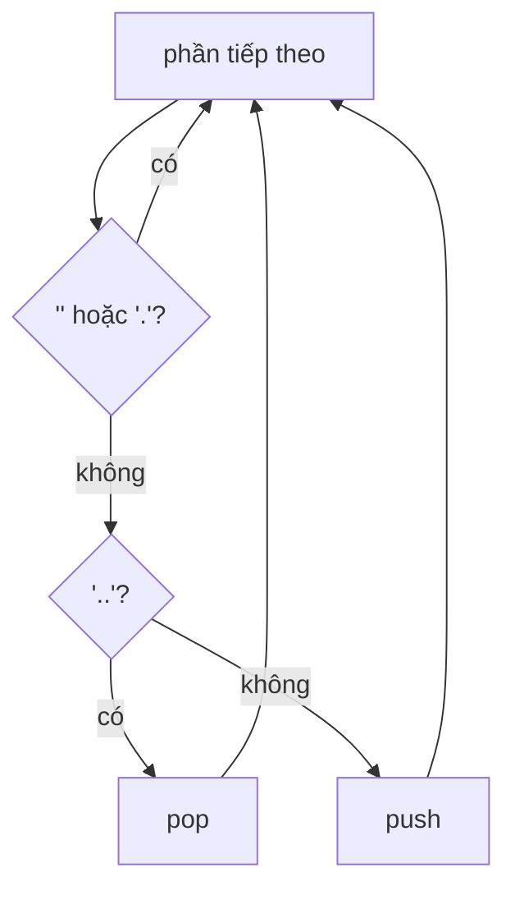

<!-- approaches: Stack of directory names -->
# 71. Simplify Path

**Medium** · String · Stack · [LeetCode ↗](https://leetcode.com/problems/simplify-path/) · Code: [SimplifyPath.java](SimplifyPath.java) · Tests: [SimplifyPathTest.java](SimplifyPathTest.java)

## Đề bài

Rút gọn đường dẫn tuyệt đối kiểu Unix: `.` là thư mục hiện tại, `..` lên một cấp, nhiều `/` liền nhau coi như một, tên khác (kể cả `...`) là tên thư mục.

```
"/home/user/Documents/../Pictures"  ->  "/home/user/Pictures"
"/.../a/../b/c/../d/./"             ->  "/.../b/d"
```

## Ý tưởng

> Tách theo `/`, đi qua từng phần như đi trong cây thư mục — dùng **stack**:
> - `""` hoặc `.` → bỏ qua;
> - `..` → pop (đang ở gốc thì thôi);
> - tên khác → push.

| phần | stack |
|---|---|
| `...` | [...] |
| `a` | [..., a] |
| `..` | [...] |
| `b` | [..., b] |
| `c` | [..., b, c] |
| `..` | [..., b] |
| `d` | [..., b, d] |
| `.` | [..., b, d] |



## Lời giải ⭐

Ghép stack từ **đáy lên đỉnh** (dùng `Deque` như hàng đợi hai đầu thay vì `Stack`), thêm `/` ở đầu. Stack rỗng → `"/"`.

## Bài liên quan

1598 Crawler Log Folder · 844 Backspace String Compare · 388 Longest Absolute File Path.
