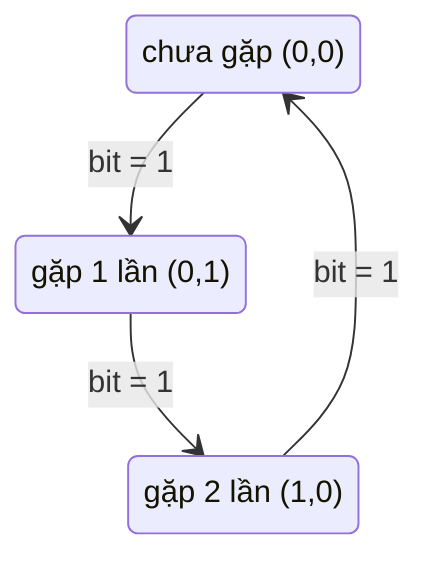

<!-- approaches: Hash map count · Count each bit mod 3 · Two-bitmask state machine -->
# 137. Single Number II

**Medium** · Array · Bit Manipulation · [LeetCode ↗](https://leetcode.com/problems/single-number-ii/) · Code: [SingleNumberII.java](SingleNumberII.java) · Tests: [SingleNumberIITest.java](SingleNumberIITest.java)

## Đề bài

Mọi phần tử xuất hiện **ba lần**, trừ một phần tử xuất hiện **một lần**. Tìm nó trong `O(n)`, bộ nhớ `O(1)`.

```
[2,2,3,2] -> 3
```

## Ý tưởng

> XOR (bài 136) chỉ triệt tiêu theo cặp. Với bộ ba: xét **từng bit**, đếm số lần bit đó bằng 1 trên mọi số. Các số lặp ba lần đóng góp bội số của 3 → `số đếm mod 3` chính là bit của số lẻ loi.

`[2, 2, 3, 2]`:

| bit | 2 | 2 | 3 | 2 | tổng | mod 3 |
|---|---|---|---|---|---|---|
| 1 | 1 | 1 | 1 | 1 | 4 | **1** |
| 0 | 0 | 0 | 1 | 0 | 1 | **1** |

→ `11₂ = 3`.

## Cách 1 — HashMap `O(n) · O(n)`

## Cách 2 — Đếm từng bit mod 3 `O(32n) · O(1)` ⭐ (dễ giải thích)

Đúng cả với số âm: bit 31 cũng được đếm và đặt lại.

## Cách 3 — Máy trạng thái hai mặt nạ `O(n) · O(1)`

Mỗi bit có một bộ đếm `0 → 1 → 2 → 0`, mã hoá bằng hai bit (`twos`, `ones`):



Hai dòng `ones = (ones ^ x) & ~twos; twos = (twos ^ x) & ~ones;` thực hiện chuyển trạng thái cho **cả 32 bit cùng lúc**. Cuối cùng `ones` giữ các bit xuất hiện 1 lần (mod 3).

## Bài liên quan

136 Single Number · 260 Single Number III · 191 Number of 1 Bits.
