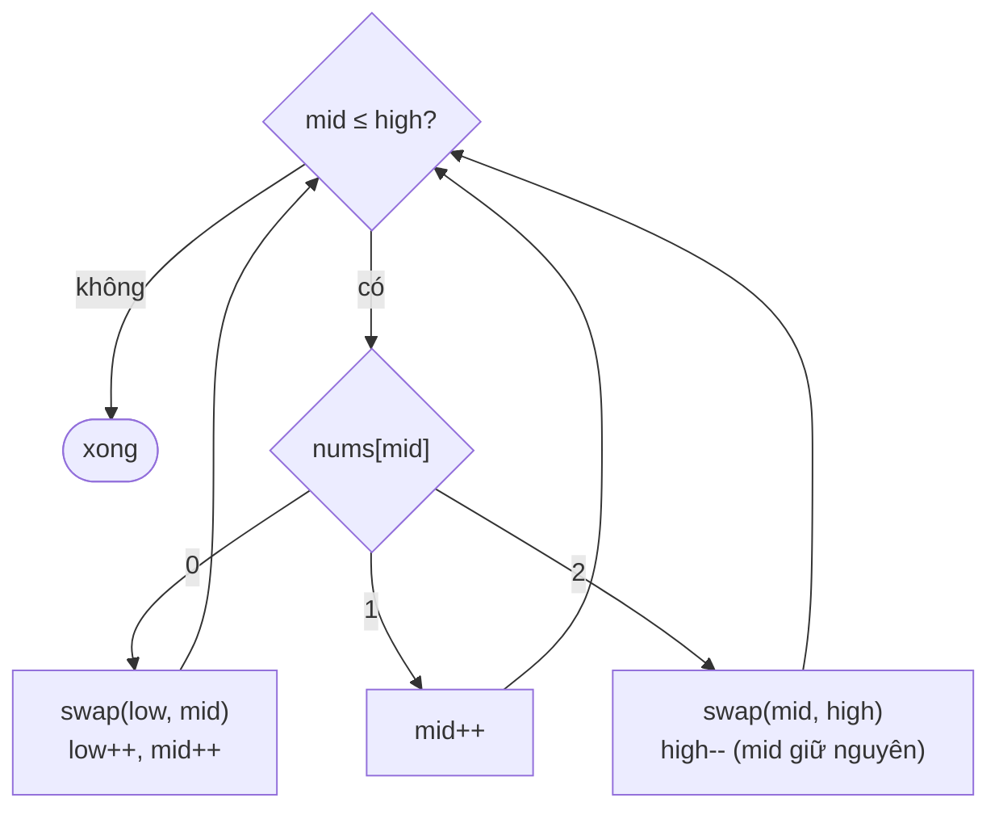

<!-- approaches: Counting sort · Dutch national flag (one pass) -->
# 75. Sort Colors

**Medium** · Array · Two Pointers · Sorting · Quicksort · [LeetCode ↗](https://leetcode.com/problems/sort-colors/) · Code: [SortColors.java](SortColors.java) · Tests: [SortColorsTest.java](SortColorsTest.java)

## Đề bài

Mảng chỉ gồm `0, 1, 2` (đỏ, trắng, xanh). Sắp xếp **tại chỗ**, không dùng hàm sort. Follow-up: **một lượt**, `O(1)` bộ nhớ.

```
[2,0,2,1,1,0] -> [0,0,1,1,2,2]
```

## Ý tưởng

> **Lá cờ Hà Lan** (Dijkstra): chia mảng thành 4 vùng bằng ba con trỏ, rồi thu hẹp vùng "chưa biết" từng bước.

```
 [ 0 0 0 | 1 1 1 | ? ? ? ? | 2 2 2 ]
 0      low     mid      high     n
```



`[2, 0, 2, 1, 1, 0]`:

| low | mid | high | mảng | |
|---|---|---|---|---|
| 0 | 0 | 5 | 2 0 2 1 1 0 | 2 → đổi với cuối |
| 0 | 0 | 4 | 0 0 2 1 1 2 | 0 → đổi với low |
| 1 | 1 | 4 | 0 0 2 1 1 2 | 0 → đổi với low |
| 2 | 2 | 4 | 0 0 2 1 1 2 | 2 → đổi với high |
| 2 | 2 | 3 | 0 0 1 1 2 2 | 1 |
| 2 | 3 | 3 | | 1 → mid = 4 > high, xong |

## Cách 1 — Đếm `O(n)`, hai lượt

## Cách 2 — Lá cờ Hà Lan, một lượt ⭐

Vì sao gặp `2` thì **không** tăng `mid`? Phần tử vừa đổi từ `high` về là phần tử **chưa xét**. Còn gặp `0` thì tăng được, vì phần tử đổi từ `low` về chắc chắn là `1` (đã xét).

## Bài liên quan

283 Move Zeroes · 905 Sort Array By Parity · 324 Wiggle Sort II · phân hoạch 3 nhánh trong Quicksort (xử lý nhiều phần tử bằng pivot).
